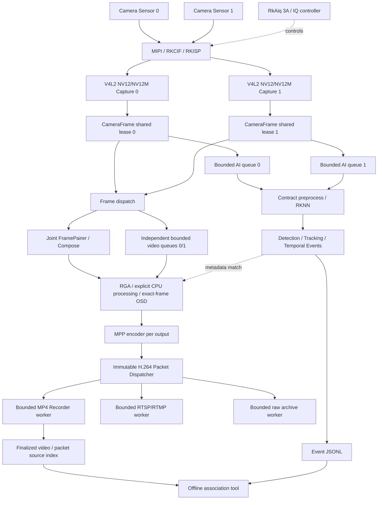

# 最终架构与所有权

Capture每路1线程；AI每路至多1 context/worker；independent每路1录像队列/编码worker，joint只有1合成输出；每个输出的raw/MP4/network分别拥有sink worker。MPP wrapper仍同步put/get，未拆成经过SDK验证的输入输出线程。没有无用Decode线程。

V4L2 DQBUF→CameraFrame/FrameLease→队列与消费者共享→最后lease释放QBUF；图像复制后硬件帧lease释放。NV12读取使用plane/stride/offset/bytesused边界，MPP有独立对齐输入buffer。CPU拷贝存在，不声称零拷贝。packets共享不可变字节直到所有消费者完成。

shutdown停止生产、关闭队列、join消费者与sink、finalize录像、释放残留lease，然后STREAMOFF/munmap/close。硬件完成/EOS语义待实际SDK证据。网络超时恢复与录像独立，磁盘异常显式失败；所有SDK/实机路径标记HARDWARE_UNVERIFIED。
