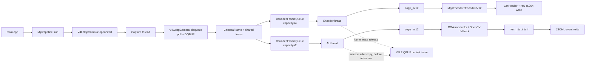

# RK3588 Camera/ISP 架构收敛与问题修复报告

> **历史报告：2026-11-12 单路架构收敛阶段。**
>
> 正文中的“当前”“只定位单路”、MipiPipeline 调用图和测试结果均属于当时基线；后续双路 DualCameraPipeline 与 VirtualSensor / Software ISP 已扩展该结构。保留本报告作为阶段证据，不能用其旧约束、旧线程图或测试状态代替当前实现。
>
> 现行依据：[当前架构](CURRENT_ARCHITECTURE.md) · [执行与验证状态](CODEX_EXECUTION_STATUS.md)。范围说明更新：2026-11-16（Asia/Shanghai）。

日期：2026-11-12（Asia/Shanghai）  
状态：`IMPLEMENTED_AWAITING_HARDWARE`

## 1. 收敛目标与范围

项目现在只定位为“基于 RK3588 的 MIPI Camera/ISP 实时录像与单模型 AI 事件识别系统”。入口、CMake 和 README 均只描述这一条产品链路：

```text
Sensor/CSI/ISP（RK3588 BSP 外部能力）
  -> V4L2 NV12/NV12M Capture
  -> Capture thread
      -> bounded recorder queue(4) -> Encode thread -> MPP H.264 -> raw .h264
      -> bounded AI queue(2)       -> AI thread -> RGA/CPU -> one RKNN model -> JSONL
```

不重新实现 Sensor Driver、Media Controller、ISP 算法或 rkAIQ；这些依赖目标 BSP、Sensor、IQ 文件和板端控制工具。

## 2. 删除的 Legacy 业务文件与模块

在确认 `rg` 无新主链路引用后，以下文件从仓库和构建目标移除，Git 删除保留历史：

- FFmpeg/RTSP/MP4 输入和 MPP 解码：`include/stream_loader.h`、`lib/stream_loader.cpp`、`include/mpp_decoder.h`、`lib/mpp_decoder.cpp`。
- 四模型调度、检测融合和四宫格：`include/detection_fusion_manager.h`、`lib/detection_fusion_manager.cpp`。
- RTMP/RTSP/FLV 推流管理：`include/streaming_manager.h`、`lib/streaming_manager.cpp`。
- 旧四宫格 DMA 分配和线程池支撑：`include/dma_alloc.hpp`、`include/ThreadPool.hpp`、`include/m_buffer.hpp`。

`main.cpp` 已删除 `run_legacy`、四模型实例、四宫格线程和 RTMP 初始化；`CMakeLists.txt` 不再使用 `file(GLOB lib/*.cpp)`，而是显式列出单 MIPI 所需源文件，避免旧业务文件重新进入构建。

## 3. 保留的公共组件

- `V4L2IspCamera`：V4L2 capability/format/plane/fps 协商、MMAP、EXPBUF 能力记录、poll、DQBUF/QBUF、停止和清理。
- `CameraFrame`、`BufferLeaseState`、`FrameLease`：CameraState 统一拥有 mmap/fd，消费者共享 lease。
- `BoundedFrameQueue`：有界队列、关闭通知和可观察的丢旧策略。
- `MppEncoder`：现有 MPP H.264 编码器和 RGA/OpenCV I420 转换；继续使用 CPU packed NV12 基线。
- `rknnPool.hpp`、`rknn_api.h`、`postprocess.cpp`：单 RKNN 模型推理和后处理；明确拒绝多输入模型，改用 `std::vector` 输出缓冲并检查 release 返回值。
- `RGA`：NV12→BGR/I420 的转换，RGA 失败时保留 CPU/OpenCV fallback。

没有把 V4L2 EXPBUF 描述为下游 DMA-BUF import；当前实现仍是 mmap + CPU copy。

## 4. 新主链路真实调用图



Capture 线程只负责 DQBUF、统计和有界入队；它不执行 MPP、模型推理或磁盘写入。Encode 线程独占 MPP encoder 和 H.264 文件；AI 线程独占模型和事件文件。

## 5. 线程、队列和背压策略

| 线程 | 职责 | 队列/策略 |
| --- | --- | --- |
| Capture | `poll`/DQBUF、验证已协商布局、创建 `CameraFrame`、更新 capture 统计、分发到两个队列 | 录像队列容量 4，满时丢最旧项并累加 `record_queue_drop` 与 `capture_drop`；AI 队列容量 2，满时丢最旧项并累加 `ai_drop_oldest`。 |
| Encode | 从录像队列取帧、按 stride 打包、调用 MPP、写 SPS/PPS 和 raw H.264 | 录像队列关闭后排空；MPP 错误、无 packet、header/文件写失败会设置 pipeline failure，停止后续采集。 |
| AI | 从 AI 队列取帧、复制/颜色转换后立即释放 CameraFrame、执行限频单模型推理、写 JSONL | `ai_fps` 控制提交周期；模型慢时只影响 AI 队列和 AI skip/drop 统计，不能阻塞 Capture/Encode。 |

三个线程均通过 `stop` 和队列 `close()` 有界退出。Capture 结束后关闭两个队列，Encode/AI 排空后 join，再进入 Camera stop。

## 6. Camera Buffer 生命周期与硬件完成点

1. `CameraState` 唯一持有 V4L2 MMAP 映射、EXPBUF fd 和 slot 状态 `Queued → Dequeued → InUse → Queued`。
2. DQBUF 时保存 `plane_count`、每 plane `sizeimage`、`bytesused`、`data_offset`、Y/UV stride、sequence、timestamp flags 和 timestamp。无法证明的 offset/bytesused/stride/layout 直接拒绝并 QBUF 回收。
3. `CameraFrame` 的 `owner` 和 `FrameLease` 都强持有 CameraState；录像和 AI 复制 frame 只增加共享 lease，不可自行 close/munmap/QBUF。
4. 最后一个 lease 释放时才调用 QBUF；`stop_accepting()` 后不再产生新的 QBUF，`stop()` 等待 in-flight lease 为零，再 STREAMOFF、munmap、close。STREAMOFF 失败也继续执行最终关闭，并返回错误。
5. 当前录制路径在进入 MPP 前先完成 CPU copy；AI 在 RGA/CPU 转换后、模型调用前释放 CameraFrame。因此 RKNN 慢不会延长 camera slot 占用。
6. MPP `encode_put_frame` 成功后立即释放 frame wrapper；packet 未取得、timeout 或非 timeout 错误时，输入 `MppBuffer` 标记为 pending，`MppEncoder::Encode` 返回负值并使 encoder faulted，不把异常当作正常 drop。没有假设未知 BSP 的异步 reset 已经完成；pending buffer 保留到 encoder context teardown 后才释放。目标 BSP 仍需确认其实际 completion/teardown 语义和压力行为。

## 7. 已修复的问题

- 删除 Legacy 构建和入口依赖，避免两套独立 Pipeline 并存。
- V4L2 增加实际 G/S_PARM fps 读取；未知 fps fail-closed，不把请求值伪装成协商值。
- 完整校验 NV12/NV12M plane 数、stride、sizeimage、`data_offset`、`bytesused` 和单/多平面 UV 地址；异常 DQBUF index、poll revents、payload 错误会停止流并进入清理。
- 修复 CameraFrame owner/lease 可拆分问题：FrameLease 保持 CameraState 生命周期。
- Capture/Encode/AI 拆成独立线程和有界队列；AI 限频、丢旧帧，磁盘写不再发生在 Capture 线程。
- MPP 编码参数、输入尺寸、packet 缓冲和返回值增加检查；timeout/硬件错误返回负值，header 获取失败不再写“成功”的坏码流。
- RKNN 明确拒绝多输入模型，移除非标准 VLA，检查 `rknn_outputs_release` 返回值，删除拷贝语义。
- `MipiPipeline` 标记为单次生命周期，避免复用已关闭队列和 stop 状态。

## 8. 尚未修复/尚未验证的问题

- 当前环境无法确认目标 BSP 的 MPP timeout、context destroy、packet ownership 和输入 buffer completion 细节；代码采用保守 pending/teardown 策略，但不能把它写成板端验证通过。
- 未启用 DMA-BUF import。目标 BSP 的 MPP/RGA import API、stride/offset、cache sync、fence 和 release 生命周期需要实测后单独实现。
- MPP packet 仍使用固定大小工作缓冲；若目标码流超过该容量，Encode 返回错误，未实现动态 packet pool。
- `rknn_lite` 仍依赖现有模型输出布局和 `post_process` 约定；模型输入/输出元数据需由目标模型验证。
- Capture 录像队列满时会丢最旧录像帧，这是明确、可观测的背压策略；若产品要求绝不丢录像帧，需要板端测得的编码吞吐和更大 buffer pool，不能通过无界队列掩盖。

## 9. 实际测试与结果

本次实际执行：

- `python tests/validate_project.py`：PASS (20 required files)。
- `git diff --check`：PASS。
- `rg` 依赖审计：确认已删除 11 个 Legacy 文件不再被新主链路引用；CMake 只列出 MIPI 源文件。
- CMake configure/build/CTest：未执行，当前 Windows PATH 没有 CMake、CTest、g++、clang++ 或 cl.exe。
- Linux V4L2/MPP/RGA/RKNN 构建、ASAN/UBSAN、真实 Camera、慢 AI、长稳测试：未执行，缺少 Linux/厂商 SDK/RK3588/模型/设备。
- `bash -n scripts/isp_probe.sh`：当前 Windows 沙箱无法启动 bash，需 Linux/板端执行。

因此结构检查通过不能等同于编译通过或硬件通过。

## 10. 仍需 RK3588 板端验证

- Sensor 型号、I2C、DTS endpoint、CSI/DPHY、Media Controller graph、ISP mainpath/selfpath 节点和实际 NV12/NV12M layout。
- rkAIQ/IQ 文件、AE/AWB、曝光/gain 设置与回读接口；无 BSP API 证据时不在本仓库伪造控制调用。
- `G_PARM/S_PARM` 实际 fps 与 DQBUF timestamp clock domain。
- MPP encoder 输入 stride/alignment、`encode_put_frame/get_packet` timeout 和 context teardown completion；确认 pending buffer 在硬件停止访问后才释放。
- RGA 输入 stride、cache sync、异步 job/fence 及失败 fallback；RKNN 模型输入输出和 NPU 负载。
- 录像队列/AI 队列容量、慢磁盘/慢编码/慢模型下的丢帧和端到端延迟，30/60 分钟 RSS/CPU/错误统计。
- raw H.264 SPS/PPS、码流连续性、实际播放器/解码器可读性。
