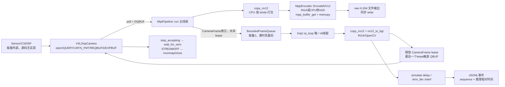

# RK3588 Camera/ISP 实时多媒体工程审查报告

审查日期：2026-11-12（Asia/Shanghai）  
审查范围：当前仓库源码、CMake、README、脚本、已有测试和 `CODEX_CAMERA_ISP_EXECUTION_PLAN.md`  兼容性：仅新增本报告，未修改业务实现。

## 1. 总体结论

当前仓库已经形成一条可读的“legacy 输入 + mipi 输入”软件骨架：legacy 仍走 FFmpeg → MPP Decode → RGA/RKNN → 四宫格 → RTMP/FLV；mipi 入口实现了 V4L2 NV12/NV12M 协商、MMAP、可选 EXPBUF、poll/DQBUF/QBUF、MPP H.264 elementary stream 输出，以及容量为 2 的 AI 队列。源码层面可以证明这些接口和调用路径存在，不能证明其已经编译、在 RK3588 上运行或通过长时间稳定性验证。

项目当前**未达到完整软件实现目标**。最关键的原因是：

1. MIPI/ISP 路径没有任何真实 Sensor、Media Controller、rkAIQ、IQ 文件或板端日志证据，`/dev/video0` 只是默认值，不能被称为已完成 ISP 适配。
2. V4L2 的 plane offset、sizeimage、实际帧率和时间戳时钟域没有完整保留；异常 DQBUF index、异常 revents 和部分资源错误路径没有安全闭环。
3. MPP 编码在采集线程同步执行，且 `encode_get_packet` 超时或非 timeout 错误会被当作 packet size 为 0 的正常返回；在未确认 MPP 完成语义时释放输入 buffer，存在硬件仍访问已释放 buffer 的 P0 风险。

它可以作为一份有一定工程内容的 Linux Multimedia/嵌入式 C++ 集成 Demo 来讲：代码确实包含 V4L2 ioctl、RGA/MPP/RKNN、bounded queue 和 lease 设计。但目前不适合把“RK3588 MIPI RAW → rkAIQ/ISP → DMA-BUF 零拷贝 → 稳定录像”作为已经完成的简历结论；更准确的表述是“实现了待板端验证的 V4L2 NV12 采集适配和录像/AI 软件路径”。

## 2. G0～G6 完成度矩阵

| 阶段 | 状态 | 源码/测试证据 |
| --- | --- | --- |
| G0 工程结构与旧代码兼容 | PARTIAL | `main.cpp:207-260` 保留 legacy，`lib/stream_loader.cpp:204-339` 仍有 FFmpeg/MPP 解码；但 `CMakeLists.txt:36-55` 硬编码兄弟目录依赖，`include/stream_loader.h:91-99` 固定 MP4 路径，当前没有 legacy 运行回归证据。 |
| G1 输入层设计 | PARTIAL | `main.cpp:281-328` 选择 legacy/mipi；`lib/mipi_pipeline.cpp:341-355` 绕过解码器读取 NV12 后编码；但默认设备仍是 `include/app_options.h:14` 的 `/dev/video0`，EXPBUF fd 未传给下游，实际走 CPU copy，源时间戳也未完整传递。 |
| G2 V4L2 Camera/ISP | PARTIAL / NOT VERIFIED | `lib/v4l2_isp_camera.cpp:191-419` 实现 QUERYCAP、格式枚举/S_FMT、REQBUFS、QUERYBUF、EXPBUF、QBUF、STREAMON；`423-462` 实现 poll/DQBUF；`533-555` 实现 STREAMOFF/清理。没有真实 V4L2 设备测试；没有 G_FMT/S_PARM/G_PARM，未检查 poll revents，plane offset/sizeimage 校验不完整。 |
| G3 MPP + RKNN 双分支 | PARTIAL | `lib/mipi_pipeline.cpp:313-423` 录像先于 AI，AI worker 使用 `BoundedFrameQueue(2)`；但编码、文件写入和采集在同一线程，MPP 错误可能被吞成 `encode_drop`，没有独立 encoder 任务队列或 P95/端到端延迟测试。 |
| G4 DMA-BUF 与 Buffer 生命周期 | PARTIAL | `include/camera_frame.h:44-151` 提供共享 lease，`tests/camera_lifecycle_test.cpp:12-60` 覆盖最后一个 lease 才回收和丢旧队列；但 `lib/mpp_encoder.cpp:321-349` 未证明 timeout 后硬件已完成访问，且 CameraFrame 的 `owner` 与 `lease` 可被调用者分离。EXPBUF 只导出不导入，不能称为全链路零拷贝。 |
| G5 rkISP/rkAIQ/硬件适配 | BLOCKED | 全仓库没有 Sensor/DTS/rkAIQ API、IQ 文件、AE/AWB 或曝光控制调用；只有 `scripts/isp_probe.sh` 和 `docs/isp_migration/03_isp_bringup.md` 的只读探测清单。`docs/isp_migration/hardware/README.md:3-12` 明确没有板端证据。 |
| G6 构建、测试、性能 | PARTIAL / NOT VERIFIED | 当前实际运行 `python tests/validate_project.py`，结果 `PASS (19 required files)`；CMake/CTest、C++ host test、ASAN/UBSAN、legacy 回归、AI 慢消费者和长时间测试均未在当前环境执行。 |

## 3. 问题清单

### P0：可能造成数据错误、内存破坏或硬件访问已释放内存

#### P0-001：MPP 超时/错误路径释放输入 buffer，但没有完成语义证明

- 文件/行号：`lib/mpp_encoder.cpp:321-349`。
- 问题：`encode_put_frame` 成功后最多轮询 50 次 `encode_get_packet`。timeout 耗尽或返回非 `MPP_ERR_TIMEOUT` 时，代码直接 `mpp_buffer_put(buffer)`、`mpp_frame_deinit(&frame)` 并返回 0。仓库没有证明这些返回路径代表硬件已经停止读取该 buffer。
- 触发条件：MPP 编码器暂时无 packet、硬件调度延迟、驱动返回非 timeout 错误或板端负载升高。
- 影响：如果 MPP 仍持有输入 buffer，可能发生图像损坏、use-after-free、随机崩溃；上层还会把错误误判为正常丢包。
- 最小修改建议：按目标 BSP 的 MPP API 语义增加明确的完成/flush/丢弃协议；在完成确认前保留 `MppFrame/MppBuffer`，并把 timeout/非 timeout 错误向上返回。
- 验证方式：板端注入编码延迟和停止/恢复压力，检查 buffer 完成回调或官方同步语义；ASAN 只能辅助，不能替代 MPP 完成证据。

### P1：主链路缺失、行为不正确或关键需求未完成

#### P1-001：V4L2 plane offset/sizeimage/UV stride 未形成完整契约

- 文件/行号：`lib/v4l2_isp_camera.cpp:303-305,339-363,491-516`；`lib/mipi_pipeline.cpp:54-77`。
- 问题：只验证 `stride_y >= width`；未保存或校验 `v4l2_plane.data_offset`、`plane_fmt[].sizeimage`、`bytesused` 和 `stride_uv >= width`。单平面 NV12 直接用 `stride_y * height` 推导 UV 起点，多平面直接使用 plane 映射基址。
- 触发条件：驱动返回非零 data offset、UV stride 不同、带 padding 的 NV12/NV12M 或异常 sizeimage。
- 影响：颜色错位、读取错误 plane，严重时 `copy_nv12` 越界读取或编码失败。
- 最小修改建议：保存每个 plane 的 offset/sizeimage/bytesused，按实际布局计算可读范围；无法证明布局时拒绝该格式。
- 验证方式：用 mock/真实设备覆盖单平面、多平面、非零 offset、不同 Y/UV stride，并用边界填充检查读取范围。

#### P1-002：实际帧率未协商，编码时间基使用请求值

- 文件/行号：`lib/v4l2_isp_camera.cpp:375-380`；`lib/mipi_pipeline.cpp:258-260`。
- 问题：`Capabilities.fps` 直接复制 `config_.fps`，代码没有 `VIDIOC_G_FMT`、`VIDIOC_S_PARM` 或 `VIDIOC_G_PARM`；MPP 初始化也使用请求帧率。
- 触发条件：设备只能提供另一帧率，或驱动忽略请求值。
- 影响：输出时间基、统计 FPS、录像节奏和真实采集节奏不一致。
- 最小修改建议：读取并保存实际 stream parameter；若无法获得有效帧率，明确标记未知，不把请求值伪装成协商结果。
- 验证方式：在支持多个 frame interval 的节点上比较 `G_PARM`、DQBUF 间隔和输出时间基。

#### P1-003：编码和文件写入阻塞采集线程

- 文件/行号：`lib/mipi_pipeline.cpp:313-397`。
- 问题：同一个 `run()` 线程依次执行 DQBUF、CPU 打包、`EncodeNV12`、文件写入，然后才提交 AI。MPP 的 50 ms 轮询和磁盘写阻塞会停止下一次 DQBUF。
- 触发条件：编码器负载、输出介质抖动或短时写阻塞。
- 影响：V4L2 队列被耗尽，采集延迟和丢帧扩大；“AI 不阻塞录像”成立，但“录像与采集解耦”不成立。
- 最小修改建议：先保持相机 lease 的明确完成语义，再把编码提交/输出放入有界录像队列；录像队列满时单独报错，不静默丢帧。
- 验证方式：注入慢编码/慢磁盘，观察 DQBUF 间隔、在途 buffer 数和 capture/encode drop 分类。

#### P1-004：MPP 错误被伪装成正常 encode drop

- 文件/行号：`lib/mpp_encoder.cpp:336-349`；`lib/mipi_pipeline.cpp:357-365,392-396`。
- 问题：`encode_get_packet` 非 timeout 错误和 timeout 耗尽均返回 0、packet size 0；上层只增加 `encode_drop`，不增加 `encode_errors`。
- 触发条件：MPP 返回硬件错误、超时或 packet 暂未准备好。
- 影响：坏状态可能持续运行，最终报告看似只是丢帧，无法区分硬件失败和正常无输出。
- 最小修改建议：区分 timeout、硬件错误、输出 buffer 太小；非可恢复错误返回负值并终止或进入明确 fallback。
- 验证方式：mock MPP 返回各错误码，检查 pipeline 返回值和统计字段。

#### P1-005：DMA-BUF 只导出不使用，核心目标未实现

- 文件/行号：`lib/v4l2_isp_camera.cpp:354-363`；`lib/mipi_pipeline.cpp:341-355`；`lib/mpp_encoder.cpp:296-318`。
- 问题：V4L2 仅调用 EXPBUF 保存 fd；pipeline 先逐行 CPU copy，MPP 再申请自己的 buffer 并 `memcpy`。RGA/RKNN 也没有导入 camera fd 的路径。
- 触发条件：任何 mipi 运行。
- 影响：至少存在 camera→packed NV12、packed→MPP buffer 两次复制，CPU 带宽和延迟上升；不能把该链路描述为 DMA-BUF 全链路零拷贝。
- 最小修改建议：先保留明确的 copy path，再针对目标 BSP 实测 MPP/RGA DMA-BUF import；只有完成语义、stride/offset 和释放协议都验证后再切换。
- 验证方式：板端记录 fd import、cache sync、完成通知和 buffer reuse，比较 CPU/RSS/端到端延迟。

#### P1-006：非法 DQBUF index 没有恢复或停止流

- 文件/行号：`lib/v4l2_isp_camera.cpp:464-466`。
- 问题：当驱动返回越界 index 时直接返回 `nullopt`，没有 STREAMOFF、错误计数或释放已出队状态。
- 触发条件：驱动异常、设备断开或 ABI/模拟设备返回非法 index。
- 影响：采集池可能永久少一个 buffer，后续 poll/DQBUF 行为不可预测，退出可能卡住。
- 最小修改建议：记录错误、停止采集并进入统一 shutdown；确保已出队 buffer 不会被重复使用。
- 验证方式：mock 非法 index，验证 pipeline 有界失败且 fd/mmap 全部清理。

#### P1-007：CameraFrame 的 owner 与 lease 可被调用者分离

- 文件/行号：`include/camera_frame.h:145-151`。
- 问题：资源 owner 和归还 lease 是两个公开的 shared pointer。接口没有强制二者绑定；若调用方保存 lease 却释放 owner，`CameraState::shutdown()` 可能在仍有 in-flight lease 时超时，随后对象销毁而不再执行清理。
- 触发条件：下游只保留 lease、手工拆分 frame 元数据，或异常队列持有方式。
- 影响：fd/mmap 泄漏或 lease 无法再 QBUF，长期运行会耗尽采集资源。
- 最小修改建议：将 owner/lease 封装在不可拆分的 token 中，或让 lease 自己强持有 CameraState，并为 QBUF 失败提供可观察状态。
- 验证方式：构造 owner/lease 不同生命周期的 mock，跑析构和 stop 超时场景。

#### P1-008：legacy H.264 bitstream filter 使用错误的 stream 参数

- 文件/行号：`lib/stream_loader.cpp:238-246,289-291`。
- 问题：视频流索引保存在 `videoStreamIndex`，但 BSF 参数却固定取 `fmtCtx->streams[0]`。
- 触发条件：MP4/RTSP 中音频或数据流排在 stream 0、视频不在第一个流。
- 影响：`h264_mp4toannexb` 初始化参数错误，legacy 输入可能打不开或解码异常。
- 最小修改建议：始终使用 `videoStreamIndex`，并检查 `avcodec_parameters_copy` 返回值。
- 验证方式：准备视频流索引不为 0 的 MP4/RTSP 样本做回归。

#### P1-009：RKNN 类只分配一个 input，却按模型 input 数量调用

- 文件/行号：`include/rknnPool.hpp:45,124-145,235`。
- 问题：成员是 `rknn_input inputs[1]`，构造函数只拒绝 `n_input == 0`，`interf()` 却把 `io_num.n_input` 传给 `rknn_inputs_set`。
- 触发条件：加载多输入 RKNN 模型。
- 影响：越界读取 input 数组，导致内存破坏或推理崩溃。
- 最小修改建议：明确拒绝 `n_input != 1`，或按实际数量动态分配并初始化所有 input。
- 验证方式：用多输入模型元数据 mock，验证初始化失败而不是进入 `interf()`。

#### P1-010：AI 线程没有有界取消机制，退出可能无限等待

- 文件/行号：`lib/mipi_pipeline.cpp:140-195,197-200`。
- 问题：`close_ai()` 只关闭队列并无条件 `join()`；`model->interf()` 期间没有超时、取消或 watchdog。
- 触发条件：RKNN/NPU 驱动卡死、模型调用异常长阻塞或板端资源错误。
- 影响：`run()` 和析构无法继续到 `camera.stop()`，V4L2 STREAMOFF 和 fd 回收被拖住。
- 最小修改建议：在模型调用边界定义可验证的超时/隔离策略；至少让退出状态和超时被记录，并对不可取消的 SDK 调用明确板端限制。
- 验证方式：注入阻塞模型调用，确认进程能有界报告并完成资源回收。

#### P1-011：STREAMOFF 失败时没有强制完成资源回收

- 文件/行号：`lib/v4l2_isp_camera.cpp:543-555`。
- 问题：`VIDIOC_STREAMOFF` 返回除 `EINVAL` 外的错误时，`stop()` 直接返回 false，不执行 `state_->shutdown()`、不关闭 fd，也不置 `streaming=false`。
- 触发条件：设备断开、驱动在异常状态拒绝 STREAMOFF，或权限/状态变化。
- 影响：调用方若忽略返回值，fd/mmap 长期保留；析构再次 stop 也可能重复失败。
- 最小修改建议：记录 STREAMOFF 错误后进入分层清理，确保 fd/mmap 至少最终关闭，并保留“驱动状态未知”标记。
- 验证方式：mock STREAMOFF 失败，检查析构后 fd、映射和线程均已回收。

#### P1-012：H.264 header 获取失败仍继续写并报告成功

- 文件/行号：`lib/mipi_pipeline.cpp:367-379`。
- 问题：`GetHeader()` 失败或返回空 header 时，代码不设置 error，只要 `ofstream` 状态正常就把 `header_written` 置为 true。
- 触发条件：MPP extra info 尚未就绪、SDK 不支持该调用或 header 缓冲不足。
- 影响：raw H.264 可能缺 SPS/PPS，输出不可解码，但 pipeline 仍返回成功。
- 最小修改建议：把 header 失败作为明确错误，或实现经过验证的 header 获取/重复尝试策略。
- 验证方式：mock `GetHeader` 失败，确认命令非零退出且输出状态可诊断。

#### P1-013：MipiPipeline 公共对象不可安全复用

- 文件/行号：`lib/mipi_pipeline.cpp:215-220,426-428`；`include/mipi_pipeline.h:46-59`。
- 问题：第一次运行结束后 `stop` 保持 true，AI 队列保持 closed；头文件没有声明对象只能单次 `run()`。
- 触发条件：上层尝试停止后重新开始采集，或测试复用同一 pipeline 实例。
- 影响：第二次运行立即退出，AI 队列也不能接收任务。
- 最小修改建议：明确单次生命周期并在接口中禁止重复运行，或在 run 前重建 stop/queue/encoder 状态。
- 验证方式：连续调用两次 run，检查第二次返回值、资源和统计状态。

### P2：性能、可维护性和可测性问题

#### P2-001：poll 把错误事件放入 events，却不检查 revents

- 文件/行号：`lib/v4l2_isp_camera.cpp:429-443`。
- 问题：监听了 `POLLERR|POLLHUP`，但只判断 `poll()` 返回值，不检查 `descriptor.revents` 中的 `POLLERR/POLLHUP/POLLNVAL`。
- 影响：设备断开时可能反复进入 DQBUF，错误定位和退出延迟。
- 建议：在 revents 不是可读时记录具体事件并进入有界错误处理。

#### P2-002：源时间戳没有保留时钟域，AI 事件写的是推理相对时间

- 文件/行号：`lib/v4l2_isp_camera.cpp:500-503`；`lib/mipi_pipeline.cpp:402-405,184-191`。
- 问题：V4L2 timeval 被转换成 ns，但没有保留 `V4L2_BUF_FLAG_TIMESTAMP_*`；`AiItem.timestamp_ns` 被赋值后未输出，JSONL 写的是 `infer_end - started`。
- 影响：事件不能与采集时刻或跨时钟域的端到端延迟可靠对齐。
- 建议：保留原始 timestamp 和 clock domain，并在事件中同时输出 capture timestamp、sequence、推理耗时和 pipeline-relative timestamp。

#### P2-003：统计字段语义错误

- 文件/行号：`lib/mipi_pipeline.cpp:433-443`。
- 问题：`capture_drop` 被赋成 `camera_stats.error_flags`，后者是 `V4L2_BUF_FLAG_ERROR` 次数，不是 capture drop 总数。
- 影响：性能报告会把错误标志误报为丢帧，无法区分 capture_drop、DQBUF error、AI skip 和 encode drop。
- 建议：分别维护 error_flags、capture_drop 和各类原因计数。

#### P2-004：MPP 接口缺少参数和返回值防护

- 文件/行号：`lib/mpp_encoder.cpp:80-110,219-231,296-311,354-363`。
- 问题：多个 `mpp_enc_cfg_set_s32` 返回值被忽略；`Encode()` 未先验证 `packet_size` 非空，且未验证 `yuv_size <= buf_size`；固定 packet 缓冲区为 `width*height*2`。
- 影响：配置失败被静默接受，错误调用可能崩溃，极端码流可能因 packet 缓冲不足丢帧。
- 建议：统一检查 SDK 返回值、指针和整数溢出，按实际 packet 上限或可扩展输出缓冲处理。

#### P2-005：host 构建没有覆盖新增链路，CMake 依赖路径不可移植

- 文件/行号：`CMakeLists.txt:17-29,36-72,89-103`。
- 问题：`isp_host_tests` 只编译 `tests/camera_lifecycle_test.cpp` 和 `lib/app_options.cpp`，不会编译 `v4l2_isp_camera.cpp`、`mipi_pipeline.cpp`、MPP/RGA/RKNN；vendor 依赖固定在 `../rknn`、`../mpp` 等目录，无 `find_package` 或 toolchain 约束。
- 影响：host PASS 不能证明新链路可编译；换机器或交叉编译环境容易出现隐藏错误。
- 建议：把可独立编译的 V4L2/lease/layout 逻辑拆为无厂商依赖测试目标；使用可覆盖的 CMake cache/toolchain 变量。

#### P2-006：RKNN 资源和语言边界不够稳健

- 文件/行号：`include/rknnPool.hpp:240-305`。
- 问题：使用非标准 C++ VLA `rknn_output outputs[io_num.n_output]`；`rknn_outputs_release` 返回值被覆盖后最终总是 `return 0`；类未删除拷贝构造/赋值，含有裸资源指针。
- 影响：不同编译器行为不一致，释放失败不可观测，误拷贝可能造成双重所有权。
- 建议：改用 `std::vector`，显式删除拷贝并检查释放结果。

#### P2-007：状态字段存在并发读写风险

- 文件/行号：`lib/v4l2_isp_camera.cpp:401-419,423-427,533-560`。
- 问题：`streaming` 在 ioctl mutex 保护下写入，但 `dequeue()`/`is_streaming()` 无锁读取。当前 mipi 路径单线程调用，接口本身没有声明这一限制。
- 影响：未来并发 stop/capture 时形成 C++ 数据竞态。
- 建议：统一用 mutex 或原子状态，并记录接口线程约束。

#### P2-008：性能指标不足以验收计划中的长时间稳定性

- 文件/行号：`include/mipi_pipeline.h:26-44`；`lib/mipi_pipeline.cpp:330-443`。
- 问题：只有累计帧数、平均式 FPS、最近一次 encode/AI latency、inflight 和 AI queue depth；没有 DQBUF latency、P95 推理、encoder queue depth、CPU/RSS、端到端延迟和运行时长。
- 影响：无法解释长时间背压、尾延迟或资源增长，也无法满足计划中的性能验收矩阵。
- 最小修改建议：先补充真实可取得的指标和采样窗口，再设计稳定性测试；缺失数据时继续报告 unknown。
- 验证方式：30/60 分钟板端运行保存统计快照，并与系统 CPU/RSS 采样对齐。

#### P2-009：线程池吞掉 legacy 推理异常

- 文件/行号：`include/ThreadPool.hpp:218-225`。
- 问题：任务异常被 `catch (...)` 捕获后没有日志或错误计数。
- 影响：legacy 推理失败会表现为缺少检测结果，调用方无法区分模型异常和无目标。
- 最小修改建议：记录异常上下文并把失败状态传回 inference 线程。
- 验证方式：注入任务异常，确认日志、线程退出和上层状态一致。

### P3：文档和命名问题

#### P3-001：执行计划勾选状态高于可验证证据

- 文件/行号：`CODEX_CAMERA_ISP_EXECUTION_PLAN.md:247-256`。
- 问题：G1～G6 均被勾选，但同一文档和 `docs/isp_migration/04_test_report.md:37-56` 都说明当前没有 CMake、RK3588、Sensor、rkAIQ 或板端实测。
- 建议：把勾选改成“源码/文档完成，板端验证阻塞”，避免读者将实现状态理解为验收通过。

#### P3-002：部分报告结论依赖不可复现的历史命令

- 文件/行号：`docs/isp_migration/04_test_report.md:16-20`。
- 问题：文档提到此前 clang-tidy 命令通过，但没有完整命令行、版本和输出日志；当前环境没有 clang-tidy。另有 `docs/isp_migration/04_test_report.md:48-50` 将“MPP 编码错误、无 packet 分别计数”写成已覆盖，而源码 `lib/mpp_encoder.cpp:336-349` 和 `lib/mipi_pipeline.cpp:392-396` 实际把这些情况合并为 `encode_drop`。
- 建议：保存可复现的命令、工具版本和原始输出，明确区分历史声明与本次执行。

## 4. 真实数据链路与线程架构

以下图按当前源码生成，不代表理想设计：

- 采集、编码、文件写入和 AI 入队都在 `MipiPipeline::run()` 主线程（`lib/mipi_pipeline.cpp:313-423`）。只有 `Impl::ai_loop()`（`140-195`）是独立线程。
- V4L2 slot 的 fd/mmap 由 `CameraState` 持有；消费者只复制 `CameraFrame`，最后一个 `FrameLease` 调用 `queue_slot()`。
- 当前 recorder 分支没有独立队列；MPP `encode_get_packet` 轮询和文件写是主线程阻塞点。
- AI 队列最多保留两个 `CameraFrame` lease；AI 在 copy/convert 完成后清空 lease，再执行模型调用，因此模型慢不会直接持有 camera mmap，但队列丢旧时依赖 shared_ptr 析构触发归还。
- MPP 编码器收到的是 encoder 自己的 I420 工作区，不是 V4L2 DMA-BUF fd。

## 5. 测试执行记录

### 本次实际执行

| 命令 | 结果 |
| --- | --- |
| `git status --short; git branch --show-current; git log -1 --oneline` | 工作区干净；分支 `main`；提交 `6c51a51 Remove obsolete artifacts and unused legacy scaffolding`。 |
| `python tests/validate_project.py` | 退出码 0；输出 `validate_project: PASS (19 required files)`。这是结构/token 检查，不是编译或运行验收。 |
| `bash -n scripts/isp_probe.sh` | 当前 Windows 沙箱返回 `NtCreateDirectoryObject ... E_ACCESSDENIED`，退出码 1；未把脚本语法检查写成通过。 |
| `cmake -S . -B build-host ...` | 无法执行：当前 PATH 没有 `cmake`。 |
| `cmake --build ...` / `ctest ...` | 无法执行：没有 CMake/CTest，也没有 g++、clang++ 或 cl.exe。 |
| Linux V4L2/MPP/RGA/RKNN 构建 | 未执行：当前主机没有 `linux/videodev2.h`、厂商 SDK 兄弟目录或 RK3588 设备。 |
| ASAN/UBSAN、真实 V4L2、legacy RTSP/MP4、AI 慢消费者、30/60 分钟稳定性 | 未执行，缺少编译器、依赖、样本/模型和板端。 |

仓库已有的 `docs/isp_migration/04_test_report.md` 对历史检查做了记录；本次审查只把可在当前会话复现的 Python 检查计为实际通过。

## 6. 后续最小改动计划

### P0

1. **确认并修复 MPP 完成语义**：影响 `lib/mpp_encoder.cpp`、`lib/mipi_pipeline.cpp`。先在目标 BSP 上确认 `encode_put_frame/get_packet` 的 buffer ownership 和 flush 规则，再处理 timeout/错误路径。验收标准是任何输入 buffer 释放前都有可证明的完成点，错误统计能区分 timeout 与硬件失败。

### P1

1. **建立真实 V4L2 layout 契约**：影响 `include/v4l2_isp_camera.h`、`lib/v4l2_isp_camera.cpp`、`lib/mipi_pipeline.cpp`。保存 plane offset、sizeimage、bytesused、timestamp flags 和实际 fps；拒绝无法证明的布局。验收标准是单/多平面 NV12 在 mock 与板端边界测试中无越界、色彩正确。
2. **把采集与录像提交解耦**：影响 `lib/mipi_pipeline.cpp`，依赖 P0 的完成语义。增加有界 recorder 队列或明确同步策略，不能让磁盘/MPP 长尾阻塞 DQBUF。验收标准是 AI/编码慢时能观测到各类 drop，capture 不因 AI 同步等待。
3. **修复错误传播与 legacy stream index**：影响 `lib/mpp_encoder.cpp`、`lib/mipi_pipeline.cpp`、`lib/stream_loader.cpp`。验收标准是 MPP 非可恢复错误使 pipeline 失败，视频流索引不为 0 的 MP4 可通过回归。
4. **约束 CameraFrame 生命周期和 RKNN 输入数量**：影响 `include/camera_frame.h`、`include/rknnPool.hpp`。验收标准是 owner/lease 不可拆分或有强制约束，多输入模型明确拒绝或安全支持。

### P2

1. 检查 poll revents、非法 DQBUF index 和 stop 竞态；补充错误计数和统一 shutdown。
2. 增加可编译的 host layout/queue 测试，CMake 使用可配置 toolchain/SDK 路径，并增加 `-Wall -Wextra`、ASAN/UBSAN 配置。
3. 修正 timestamp、capture_drop/error_flags、encode latency、P95 和 RSS 统计语义。
4. 用 `std::vector` 替换 RKNN VLA，删除裸资源类的拷贝操作并检查 outputs release 返回值。

### P3

1. 更新执行计划勾选状态，明确“源码实现”“本机验证”“板端验证”三种层次。
2. 为历史静态检查补充工具版本、完整命令和原始日志。

## 7. 面试官视角评价

- **Camera Driver**：可以讲 V4L2 capability、single/multi-planar、MMAP/EXPBUF、poll、DQBUF/QBUF 和 buffer lease 的设计意图；不能声称已经完成 Sensor/CSI/ISP media graph、驱动调试或真实节点适配。
- **ISP**：目前只有板端探测脚本和 bring-up 清单，没有 rkAIQ、IQ、AE/AWB 或曝光回读源码，ISP 经验必须表述为待板端联调。
- **Linux Multimedia**：FFmpeg、MPP Decode/Encode、RGA、RKNN 的实际调用存在，且保留了 legacy 路径；但 DMA-BUF 没有下游导入，MPP 完成语义和时间基仍是追问点。
- **嵌入式 C++**：RAII/智能指针、bounded queue、stop/join 和错误返回是可讲亮点；裸指针、VLA、未检查返回值、可拆分 lease/owner 和同步编码阻塞会暴露生命周期与并发边界不足。

最值得继续深入的两个工程难点是：一是目标 BSP 上 V4L2 plane/时间戳/MPP buffer ownership 的真实契约；二是录像优先的有界背压与退出协议，特别是编码慢、设备断开和消费者未归还时的可证明行为。

## 最终状态

当前项目应标记为：`IMPLEMENTED_AWAITING_HARDWARE`。  
没有证据支持 `HARDWARE_VERIFIED`；本报告未修改业务代码，也没有把结构检查、历史文档或现成 ELF 文件当成构建/板端通过。
