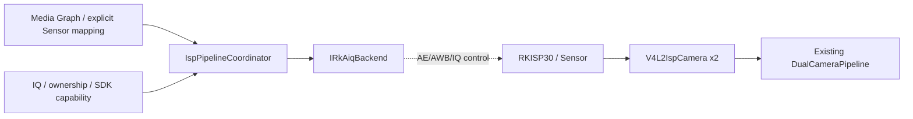

# 当前架构入口

当前实现与线程/所有权见 [Plan/FINAL_ARCHITECTURE.md](../Plan/FINAL_ARCHITECTURE.md)。实现状态见 [PROJECT_STATUS](../Plan/PROJECT_STATUS.md)，实测记录见 [08_TEST_RESULTS](../Plan/08_TEST_RESULTS.md)。旧阶段计划和生成的合成报告已从项目清理，Git 历史仍可追溯。

Software ISP 由 tools/camera_isp_demo.cpp 独立构建；它不是 RKISP 后端或产品输入模式。

## RKISP专项接入

保留既有图像流水线，新增管理线程的ISP控制阶段：配置→只读MediaGraph→SensorRegistry→RkAiq所有权/IQ验证→BSP指定before/after STREAMON→readiness→现有采集/AI/编码。关闭由guard按BSP指定before/after STREAMOFF收回所属AIQ，外部服务不init/stop。Capture线程只提供帧心跳与元数据。

默认严格，只有显式诊断允许UNVERIFIED_ISP；Fake/离线证据不会升级硬件READY。详见[专项集成](../Plan/RKISP/05_DUAL_CAMERA_ISP_INTEGRATION.md)、[健康观测](../Plan/RKISP/06_ISP_DIAGNOSTICS.md)、[真实验证](../Plan/RKISP/07_TEST_REPORT.md)。
