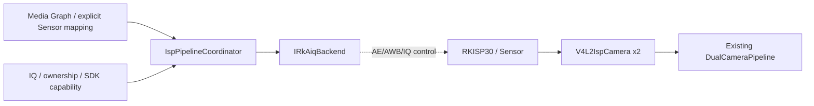

# 当前架构入口

当前实现与线程/所有权见 [Plan/FINAL_ARCHITECTURE.md](../Plan/FINAL_ARCHITECTURE.md)。本轮ISP实现状态见 [PROJECT_STATUS](PROJECT_STATUS.md)，实测记录见 [CODEX_EXECUTION_STATUS](CODEX_EXECUTION_STATUS.md)。视频/AI历史记录保留在 [Plan状态](../Plan/PROJECT_STATUS.md)与[08_TEST_RESULTS](../Plan/08_TEST_RESULTS.md)。旧阶段计划和生成的合成报告已从项目清理，Git 历史仍可追溯。

Software ISP 由 tools/camera_isp_demo.cpp 独立构建；它不是 RKISP 后端或产品输入模式。

## RKISP专项接入

保留既有图像流水线，新增管理线程的ISP控制阶段：配置→只读MediaGraph→SensorRegistry→RkAiq所有权/IQ验证→BSP指定before/after STREAMON→readiness→现有采集/AI/编码。关闭由guard按BSP指定before/after STREAMOFF收回所属AIQ，外部服务不init/stop。Capture线程只提供帧心跳与元数据。

默认严格，只有显式诊断允许UNVERIFIED_ISP；Fake/离线证据不会升级硬件READY。详见[专项集成](../Plan/RKISP/05_DUAL_CAMERA_ISP_INTEGRATION.md)、[健康观测](../Plan/RKISP/06_ISP_DIAGNOSTICS.md)、[真实验证](../Plan/RKISP/07_TEST_REPORT.md)。

## 当前控制与诊断边界

`IRkAiqBackend`统一SDK信息、生命周期、能力、IQ检查、AE/AWB/曝光/gain与回读。`AiqController`在管理路径验证owner/Sensor、能力与有限范围，将失败结果和真实确认分开；不确定rollback锁定后续生命周期与控制，直至清理。`RkAiqManager`按BSP声明的phase管理独立Camera 0/1，部分失败回滚、重复启动保护、部分关闭锁定及每路`query_all`均有Fake测试。没有SDK group能力证据时不会构造假Camera Group。

`IspPipelineCoordinator`先完成全部发现，再调用backend factory，按BSP before/after STREAMON阶段推进；阶段不能重复或倒序，stop幂等。`DualCameraPipeline`继续使用原有V4L2IspCamera与FramePairer，只在已有管理边界调用受异常保护的readiness操作。运行期状态查询拒绝错误Camera、未知owner、Error或严格模式失去确认；采集线程不执行AIQ初始化/控制。

两套CLI入口复用`src/isp/isp_cli.cpp`。Media Graph结构化JSON由同一个validator生成；角色提示只解释拓扑，映射依据仍是显式Sensor/ISP/output及启用路径。SDK版本只由backend报告，缺SDK/IPC的控制为非零失败。真SDK adapter必须由目标头/库实现并经过CMake编译链接probe；当前没有提供，真实SDK与板端仍BLOCKED_HARDWARE。

## 当前采集增量

V4L2IspCamera仍是唯一正式Camera采集实现：MMAP→DQBUF/共享lease→原AI/录像队列与FramePairer。G_FMT决定实际布局，NV12M独立Y/UV按有效行打包，主链路目前有CPU复制，EXPBUF FD未导入下游。新isp_capture只复用同一类做单路诊断，不增加产品输入。ISP文件逐路参数进入Camera，未指定CLI参数不覆盖文件；Joint要求可配对的尺寸/实际帧间隔，Independent按每路帧布局与CFR处理。readiness在协商前准备、协商后重新核验活动输出；控制和采集线程职责不变。详见[本轮实现](../RK3588_ISP_IMPLEMENTATION.md)与[测试](../RK3588_ISP_TEST_REPORT.md)。
