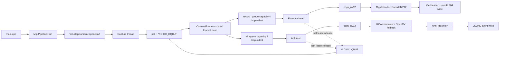

# RK3588 Camera 项目第三轮严格验收报告

审查日期：2026-11-12（Asia/Shanghai）  
审查对象：`demo_multhread_decode_infer_mulmodel`（嵌套 Git 仓库，`main`，HEAD `6085dab`）  
审查范围：只读源码、Git 历史、可执行静态检查、构建工具可用性和已有测试；本次没有修改业务源码、构建逻辑或测试用例。

## 1. 总体结论

源码结构已经收敛为一条 MIPI Camera 主链路：`main.cpp` 只创建 `MipiPipeline`，CMake 的 `myDemo` 只列出 V4L2、MPP、RGA/RKNN 相关源文件，旧 FFmpeg/RTSP/MP4 解码、四模型、四宫格和 RTMP/FLV 文件已经从当前提交和构建目标删除。这个结论有 Git 删除记录和当前 CMake 证据支持，架构收敛本身判定为 **PASS（源码结构级）**。

Capture、Encode、AI 三个线程和两个有界队列真实存在。Capture 不直接调用 MPP、文件写入或 RKNN；录像和 AI 消费者均通过 `CameraFrame` 共享 lease。CPU copy 路径使相机 mmap 不会被 MPP/RKNN 直接异步持有，但编码器的 MPP completion 语义、停止时 flush 语义和目标 BSP 版本没有证据，不能把关键硬件生命周期写成已验证安全。

原 P0/P1 问题中，5 项有直接源码修复证据，1 项因旧模块删除而 REMOVED；5 项仍为 PARTIALLY FIXED，P1-010 和 P1-013 仍 OPEN，P0-001 的 SDK completion 仍 NOT VERIFIED。当前没有可信的 C++ 编译、CTest、MPP/RGA/RKNN 运行或 RK3588 板端证据，所以软件验收不能为 PASS。

**SOFTWARE_ACCEPTANCE：PARTIAL**  
**HARDWARE_ACCEPTANCE：AWAITING_HARDWARE**

Camera/ISP 能力只达到 **L1（源码级 V4L2 NV12/NV12M 采集实现）**。没有 Media Controller graph、Sensor/CSI/ISP 实机采集、rkAIQ AE/AWB 回读或成像数据，不能宣称 L2～L5。

## 2. 审查基线和 Git 证据

实际仓库是外层工作目录下的 `demo_multhread_decode_infer_mulmodel`。外层目录没有 `.git`、`CMakeLists.txt` 或 `docs/`；在外层直接运行 Git 命令会得到 “not a git repository”。嵌套仓库审查开始时工作区干净，分支为 `main`。

历史提交：

```text
6085dab Converge project to single MIPI camera pipeline
6c51a51 Remove obsolete artifacts and unused legacy scaffolding
7b51ff8 Redact camera credentials from public source
9bd2aaa Implement RK3588 Camera/ISP pipeline
```

`git diff --stat 9bd2aaa..HEAD` 的实际结果为 39 个文件、`+1185/-3739`。只统计 `include/`、`lib/`、`main.cpp`、`tests/` 时，`9bd2aaa` 包含 29 个文件、约 6018 行，HEAD 包含 17 个文件、约 3748 行；若把 `CMakeLists.txt` 计入，则为 30→18 个文件。不存在明确的更早于 `9bd2aaa` 的改造前提交，因此不能凭空重建更早基线；本报告以 `9bd2aaa` 作为可复现的收敛前基线。

仓库根目录下的 `CODEX_CAMERA_ISP_EXECUTION_PLAN.md` 与外层工作目录同名计划存在历史冲突：外层计划仍写着保留 `legacy`，而嵌套仓库 HEAD 的计划已将 G1 改为“单路 MIPI 输入与 CLI 收敛”（嵌套计划第 242 行）。本次按用户给出的第三轮指令和当前 HEAD 的单主链路目标审查；外层旧计划只作为冲突记录，不作为当前源码功能证据。

`docs/CODE_REVIEW_REPORT.md` 是收敛前的风险基线；`docs/ARCHITECTURE_REFACTOR_REPORT.md` 是设计说明，不能代替执行结果。该报告中的“完整 plane-count 校验”“MPP 无 packet 会失败”“MipiPipeline 已禁止复用”等表述与当前源码存在不一致，以下以源码和实际命令结果为准。

## 3. 架构收敛验收

### 3.1 旧模块删除和保留情况

| 模块 | 当前状态 | 证据 |
|---|---|---|
| FFmpeg/RTSP/MP4 输入、MPP decoder | 完全删除 | `include/stream_loader.h`、`lib/stream_loader.cpp`、`include/mpp_decoder.h`、`lib/mpp_decoder.cpp` 不存在；HEAD 的 `CMakeLists.txt:31-37` 只声明 MPP/RGA/RKNN/OpenCV |
| 四模型调度、检测融合、四宫格 | 完全删除 | `include/detection_fusion_manager.h`、`lib/detection_fusion_manager.cpp`、旧四模型入口在收敛提交中删除；当前 `main.cpp:36-79` 只有 `MipiPipeline` |
| RTMP/RTSP/FLV 推流 | 完全删除 | `include/streaming_manager.h`、`lib/streaming_manager.cpp` 不存在；当前 CMake 没有 FFmpeg/RTMP 库 |
| 旧 DMA/ThreadPool 支撑 | 完全删除 | `include/dma_alloc.hpp`、`include/ThreadPool.hpp`、`include/m_buffer.hpp` 不存在 |
| RGA/MPP/RKNN 公共能力 | 源码保留并参与 MIPI 目标 | `CMakeLists.txt:68-86` 显式列出 `mipi_pipeline.cpp`、`mpp_encoder.cpp`、`postprocess.cpp`，并链接 MPP/RGA/RKNN/OpenCV |
| `--source` 参数 | 兼容性表面，不是第二条业务链 | `include/app_options.h:7-9` 只有 `Source::Mipi`；`lib/app_options.cpp:157-166` 对其他值明确报错 |

### 3.2 当前真实调用图



Capture 线程只做 DQBUF、布局验证、统计和入队（`lib/mipi_pipeline.cpp:258-324`）。Encode 线程做 copy、MPP 编码和文件写入（`lib/mipi_pipeline.cpp:197-256`）。AI 线程做 copy、颜色转换、同步 RKNN 推理和事件输出（`lib/mipi_pipeline.cpp:145-195`）。

### 3.3 过度设计判断

没有发现为了三条线程引入工厂、策略树或两套生产者消费者框架；当前只有一个 `BoundedFrameQueue` 模板、一个 `CameraFrame`/lease 契约和一个 `MipiPipeline::Impl`。相较 `9bd2aaa`，文件和代码规模明显下降，外部依赖也从 FFmpeg/旧业务栈收敛到 MPP/RGA/RKNN/OpenCV。

仍需控制两个可维护性风险：`rknnPool.hpp` 把较大的模型加载、图像转换和检测后处理实现全部放在头文件中；`MppEncoder` 没有删除拷贝构造/赋值（`include/mpp_encoder.h:19-85`），类中有裸 MPP 句柄，未来误拷贝可能造成双重释放。这两个问题不构成当前主链路并存，但属于后续 P2 清理项。

## 4. P0/P1 问题关闭矩阵

严格计数：**FIXED 5 项、REMOVED 1 项、PARTIALLY FIXED 5 项、OPEN 2 项、NOT VERIFIED 1 项，共 14 项；严格关闭 6/14。** 没有 P0 项被证据充分地标记为 FIXED。

| 问题 | 状态 | 当前源码证据和判断 |
|---|---|---|
| P0-001 MPP 超时/错误后的输入 Buffer 完成语义 | **NOT VERIFIED** | `lib/mpp_encoder.cpp:375-413` 在 timeout/错误时把 `pending_buffer_` 保留到 context teardown，`477-497` 先销毁 context 再释放 pending buffer，避免直接宣称 UAF；但没有目标 Rockchip MPP SDK 版本、completion callback 或板端压力证据。成功收到 packet 也不一定证明刚提交的 input buffer 已完成，故不能关闭 P0。 |
| P1-001 NV12/NV12M plane layout | **PARTIALLY FIXED** | `lib/v4l2_isp_camera.cpp:352-367,566-599` 已校验 plane 数范围、sizeimage、stride、data_offset、bytesused、payload 大小；`lib/mipi_pipeline.cpp:41-71` 再按实际 stride 拷贝。仍未调用 `VIDIOC_G_FMT`，且允许异常的 3+ planes 或 QUERYBUF plane_count 小于协商值（详见 NEW-P1-003），没有边界 mock 测试。 |
| P1-002 实际帧率协商 | **PARTIALLY FIXED** | `lib/v4l2_isp_camera.cpp:320-351` 尝试 G_PARM、失败后 S_PARM 再 G_PARM，无法得到值时保留 fps=0；`mipi_pipeline.cpp:375-383` 对 fps=0 fail-closed。仍把帧率压成整数，未验证 DQBUF 间隔和时间基，板端未执行。 |
| P1-003 Capture/Encode 耦合 | **FIXED（结构证据）** | `mipi_pipeline.cpp:116-120,197-324` 建立独立 Capture/Encode/AI 线程和容量 4/2 队列；Capture 不调用 MPP、文件写入或 RKNN。慢消费者压力测试因无编译器未执行，因此“源码已解耦”不能扩展为“运行时无丢帧”。 |
| P1-004 MPP 错误被伪装成 encode drop | **PARTIALLY FIXED** | timeout 返回 `-2`、其他错误返回 `-3` 并使 pipeline 失败（`mpp_encoder.cpp:399-412`、`mipi_pipeline.cpp:217-223`）。但 MPP_OK 且 packet 为空/长度为零时，`mpp_encoder.cpp:417-437` 返回 0，调用方只在 `mipi_pipeline.cpp:225-229` 累加 `encode_drop`，没有区分“无输出”和硬件错误。 |
| P1-005 DMA-BUF 只导出不使用 | **PARTIALLY FIXED（范围已调整）** | `v4l2_isp_camera.cpp:424-465` 只记录 EXPBUF 能力；`mipi_pipeline.cpp:199-214` 和 `mpp_encoder.cpp:248-307` 明确使用 CPU packed copy。README 也明确不宣称零拷贝。旧问题不应标记为“DMA-BUF 零拷贝已完成”，剩余优化需要目标 BSP import/fence/cache 证据。 |
| P1-006 非法 DQBUF index | **FIXED（静态证据）** | `v4l2_isp_camera.cpp:546-550` 检查越界 index、增加错误计数、停止流并返回错误；没有执行 mock 注入测试。 |
| P1-007 CameraFrame owner/lease 可拆分 | **PARTIALLY FIXED** | 实际 dequeue 在 `v4l2_isp_camera.cpp:651-654` 同时让 frame owner 和 FrameLease 持有 `CameraState`；`camera_frame.h:154-157` 让 lease 强持有 owner。但 `CameraFrame::owner` 和 `lease` 仍是公开且可独立 reset，`FrameLease` 构造函数的 owner 参数可为空（`camera_frame.h:133-167`），公共 API 仍可构造分离的 token。 |
| P1-008 legacy H.264 bitstream filter stream index | **REMOVED** | 相关 `stream_loader.cpp` 已从当前提交删除；当前没有 legacy 解封装目标和 bitstream filter 路径。 |
| P1-009 RKNN input 数量越界 | **FIXED（静态证据）** | `rknnPool.hpp:125-131` 明确要求 `n_input == 1`，成员 `inputs[1]` 与 `rknn_inputs_set(..., io_num.n_input, ...)` 一致；多输入模型会初始化失败。缺少多输入模型 mock。 |
| P1-010 AI 线程没有有界取消 | **OPEN** | `mipi_pipeline.cpp:145-195` 调用同步 `rknn_lite::interf`；`mipi_pipeline.cpp:434-435` 无条件 join。RKNN 调用卡住时，stop 信号不能中断它，无法保证有界退出。当前只能把这是 SDK 限制，不能用 detach 伪造完成。 |
| P1-011 STREAMOFF 失败清理 | **FIXED（静态证据）** | `v4l2_isp_camera.cpp:676-696` 记录 STREAMOFF 错误后仍调用 `shutdown()`；`shutdown()` 会重试并最终关闭 fd/mmap，返回错误给调用者。没有 mock STREAMOFF 失败测试。 |
| P1-012 H.264 header 错误处理 | **FIXED（静态证据）** | `mipi_pipeline.cpp:230-242` 在 `GetHeader()` 失败、空 header 或 header 写失败时调用 `fail()`，不会把坏码流标成成功。实际 MPP extra-info 行为仍待板端验证。 |
| P1-013 Pipeline 对象重复运行 | **OPEN** | `mipi_pipeline.cpp:361-365` 只检查线程 joinable/camera open；第一次运行在 `322-324` 关闭队列，结束时没有重建队列或重置 `failure/header_written/ai_active/counters`。第二次 `run()` 可通过检查但 push/pop 对已关闭队列立即失败，甚至可能返回空 failure 的“成功”。 |

### B1 MPP 生命周期结论

当前路径先把 V4L2 NV12 逐行复制到 `nv12`，再复制到 MPP 自己的 `MppBuffer`（`mipi_pipeline.cpp:199-214`、`mpp_encoder.cpp:350-365`）。因此相机 lease 不会直接跨入 MPP 硬件 DMA。timeout/错误分支采用保守 pending 策略是正确方向，但 `encode_put_frame` 成功后何时可以释放 MPP 输入 buffer、`encode_get_packet` 是否与当前输入一一对应、`Release()` 是否应 EOS/flush，均依赖实际 MPP SDK；`mpp_encoder.cpp:477-518` 当前直接 teardown，没有目标 BSP 证据，标记为 NOT VERIFIED。

## 5. 新发现的问题

以下只列当前审查中新发现或历史问题未覆盖的缺陷，不重复把已证明修复的问题列为新问题。

### NEW-P1-001：编码失败时关闭队列不排空，错误运行可能延迟资源回收

- 文件/行号：`lib/mipi_pipeline.cpp:217-223,322-329,432-447`；`include/bounded_frame_queue.h:49-53`。
- 触发条件：Encode 线程发生 MPP 错误并 `fail()`，录像队列仍有待处理 `CameraFrame`。
- 影响：`close()` 只设置 closed，不清空 deque；Encode 线程退出后，队列仍持有 lease，`camera.stop()` 可能在 3 秒后超时。运行中的 pipeline 对象会继续持有 mmap/fd 和帧引用，错误传播与清理时序不一致。
- 修复建议：让失败路径显式 drain 两个队列并统计丢弃原因；在 `camera.stop()` 前确认所有 lease 已释放，或为队列增加 `close_and_drain()`。
- 验证方法：注入 MPP timeout/硬件错误并预先堆满录像队列，断言 stop 不超时、所有 lease 回收、fd/mmap 最终关闭。

### NEW-P1-002：JSONL/最终文件写入失败不可完整观测

- 文件/行号：`lib/mipi_pipeline.cpp:415-421,179-193,437-441`。
- 触发条件：事件文件无法打开、磁盘写满、flush 失败或最终 close 前出现 I/O 错误。
- 影响：事件路径只打印 warning，`events << ...; events.flush()` 不检查 `events.good()`；`output.flush()/close()` 也不检查最终状态。录像或事件可能不完整，却仍可能返回成功，违反“写入失败可观测”。
- 修复建议：打开事件文件失败时按 `ai_required` 或显式策略返回错误；每次关键写/flush 检查 `good/fail/bad`，把错误写入 pipeline failure 和统计；最终 flush 失败也必须使 run 失败。
- 验证方法：使用不可写目录、配额受限文件系统或 mock stream，检查非零退出、错误字段和资源回收。

### NEW-P1-003：异常 plane 数和 QUERYBUF plane_count 不被严格拒绝

- 文件/行号：`lib/v4l2_isp_camera.cpp:352-367,397-403,569-599`。
- 触发条件：驱动为 NV12/NV12M 返回 3 个以上 plane，或 QUERYBUF 返回少于 S_FMT 协商值的 plane 数。
- 影响：代码允许 `plane_count <= VIDEO_MAX_PLANES`，但 `CameraFrame` 只暴露 plane 0/1；额外 plane 被忽略，NV12M 的异常单 plane 也可能落入连续内存分支，布局契约不再可靠。
- 修复建议：对 `V4L2_PIX_FMT_NV12` 明确要求单平面布局，对 `V4L2_PIX_FMT_NV12M` 明确要求两平面布局；QUERYBUF 必须与协商 plane_count 相等，并在必要时执行 G_FMT 回读。
- 验证方法：mock 1/2/3 plane、不同 data_offset/bytesused/stride，断言不支持布局均在 DQBUF 前后有界失败且无越界读取。

### NEW-P1-004：RKNN 查询到 NCHW 后仍强制输入格式为 NHWC

- 文件/行号：`include/rknnPool.hpp:191-209`。
- 触发条件：模型元数据 `input_attrs[0].fmt == RKNN_TENSOR_NCHW`。
- 影响：构造函数按 NCHW 读取尺寸，却无条件设置 `inputs[0].fmt = RKNN_TENSOR_NHWC`；模型可能收到错误布局，推理结果错误或运行时拒绝。
- 修复建议：按查询到的 fmt 设置 `rknn_input`，或在进入当前仅支持 NHWC 的路径时明确拒绝 NCHW；同时校验 dims、type、size 和 RGB/BGR 约定。
- 验证方法：准备 NCHW 与 NHWC 模型元数据 mock，断言输入 fmt、字节数和颜色顺序与模型契约一致。

### NEW-P1-005：DQBUF 不校验 slot 状态，异常重复 index 可能导致重复 QBUF

- 文件/行号：`lib/v4l2_isp_camera.cpp:546-555,600-608`；`include/camera_frame.h:76-103`。
- 触发条件：异常驱动或 mock 在旧 lease 尚未释放时再次返回同一 buffer index。
- 影响：代码直接把 slot 从当前状态改为 Dequeued/InUse，可能创建两个 lease；两个最后释放路径都会尝试 QBUF 同一个 slot。实际正常驱动通常不会这样返回，但源码没有把该不变量变成可检查条件。
- 修复建议：DQBUF 前确认 slot 状态为 Queued，lease 建立后原子转为 InUse；检测重复 index 时停止流并记录错误。
- 验证方法：注入重复 index、重复 QBUF 和 QBUF 失败，断言单个 slot 至多一次在途 lease，且无 double-QBUF。

### P2 残余问题

- `MppEncoder::Encode()` 只拒绝大于期望值的 `yuv_size`，允许短输入，随后把未初始化尾部提交给 MPP（`lib/mpp_encoder.cpp:322-365`）。应要求精确大小或显式清零剩余区域。
- `MppEncoder::GetHeader()` 将 `size_t` 直接转成 `int` 比较（`lib/mpp_encoder.cpp:455-474`）；固定 packet 缓冲区为 `width*height*2`，没有动态扩展策略。
- `capture_drop` 在 `mipi_pipeline.cpp:442-452` 叠加 `dqbuf_errors`，而 `error_flags` 没有独立暴露；QBUF 错误在 `camera_frame.h:87-93` 被 lease 析构吞掉，只能留在相机内部计数。
- `json_escape()` 只转义反斜杠和双引号（`mipi_pipeline.cpp:31-39`），没有处理控制字符；事件时间戳同时保留了采集值和相对值，但没有明确 wall-clock/monotonic 的统一域。
- `rknn_lite` 固定 `RKNN_NPU_CORE_0`（`rknnPool.hpp:89-103`），单模型不需要把多核调度写死；当前没有证明该绑定在目标 BSP 上有收益。
- 当前 RKNN 后处理实际是 YOLO 风格三尺度目标检测：固定 anchors/grid、`coco_80_labels_list.txt` 和 `class_num=1`（`lib/postprocess.cpp:26-33,307-329`；`mipi_pipeline.cpp:398-401`）。仓库没有目标模型文件或行为类别验证，不能把“单模型事件 JSONL”升级表述为“行为识别模型已完成”；另外 NMS 内层条件使用 `classIds[i]` 而不是候选 `classIds[j]`（`lib/postprocess.cpp:114-129`），属于模型相关的 P2 正确性待测项。

## 6. 线程和 Buffer 生命周期

### 6.1 真实线程与队列

| 线程 | 主要调用 | 队列容量 | 满载行为 |
|---|---|---:|---|
| Capture | `V4L2IspCamera::dequeue()`、统计、入队 | 录像 4；AI 2 | 两个队列均为 drop-oldest；统计分别记录 `record_queue_drop`、`ai_drop_oldest` |
| Encode | `copy_nv12()`、`MppEncoder::EncodeNV12()`、header/packet 写文件 | 4 | 编码异常调用 `fail()`；正常慢编码不会同步阻塞 Capture，但六个相机 slot 可能最终全部处于 in-flight |
| AI | `copy_nv12()`、RGA/OpenCV、同步 `rknn_lite::interf()`、JSONL | 2 | 限制提交频率；慢推理丢旧 AI 帧，不能取消正在运行的 RKNN 调用 |

Capture 不直接调用 MPP、文件写入或 RKNN。Encode/AI 的输入是 `CameraFrame` 的共享 C++ 对象；实际 MPP 和 RKNN 都使用 copy/自有内存。由于 V4L2 buffer_count 默认 6，而两个队列容量之和也是 6，最坏情况下是有限背压和可观测丢帧，并非无丢帧录制。

### 6.2 Buffer 生命周期时序

```mermaid
sequenceDiagram
    participant C as Capture thread
    participant V as V4L2 driver/slot
    participant R as Record queue
    participant A as AI queue
    participant E as Encode thread
    participant I as AI thread
    participant H as Hardware/MPP

    C->>V: VIDIOC_DQBUF(index)
    V-->>C: mapped plane pointers + bytesused/offset/sequence
    C->>C: lease_state.acquire(index), slot=InUse
    C->>R: copy CameraFrame (shared lease)
    C->>A: copy AiItem (shared lease, optional)
    R->>E: pop frame
    E->>E: copy_nv12 to owned packed buffer
    E->>H: encode_put_frame(MppBuffer owned by MPP wrapper)
    E->>E: reset CameraFrame; release one lease
    A->>I: pop AiItem
    I->>I: copy/convert NV12 to BGR
    I->>I: clear AiItem.frame before synchronous RKNN
    I->>I: release final lease when last consumer is gone
    C->>V: last lease release -> VIDIOC_QBUF(index)
    V-->>C: slot=Queued; driver may DMA again
    C->>C: stop_accepting + wait_for_zero
    C->>V: VIDIOC_STREAMOFF
    C->>V: munmap/close DMA-BUF fd and device fd
```

四种时间点必须分开理解：

1. C++ `CameraFrame`/`FrameLease` 对象销毁只代表引用计数归零；
2. DMA-BUF fd 和 mmap 由 `CameraState` 持有，消费者不能关闭；
3. MPP 硬件是否仍在读其自有 `MppBuffer` 取决于 SDK completion，不由相机 lease 决定；
4. V4L2 slot 只有在最后 lease 释放并执行 QBUF 后才可再次被驱动写入。

`BufferLeaseState::release()` 在 `camera_frame.h:76-103` 先调用 QBUF 再减少 in-flight；停止路径先 `stop_accepting()`，因此停止后不会再 QBUF，而是等待消费者归零后 STREAMOFF。正常路径的 owner/lease 强引用关系是合理的；公共字段可拆分和异常队列未 drain 是当前主要缺口。

### 6.3 实际 NV12/NV12M 布局推导

- 多平面 NV12/NV12M：plane 0 是 Y，plane 1 是交错 UV；每个 plane 的起始地址是 `mmap_base + data_offset`，可读字节数是 `bytesused - data_offset`。`dequeue()` 将这两个地址和长度写入 `CameraBufferDesc`（`v4l2_isp_camera.cpp:566-640`），`copy_nv12()` 按 `stride_y * height` 与 `stride_uv * height/2` 做边界检查后逐行复制（`mipi_pipeline.cpp:47-70`）。
- 单平面 NV12：代码把 plane 0 的映射区域视为连续 Y+UV，UV 起点为 `data + stride_y * height`（`v4l2_isp_camera.cpp:641-649`），并要求 combined `bytesused` 足以覆盖 Y 和 UV（`v4l2_isp_camera.cpp:590-598`）。
- 已处理的边界包括奇数宽高、stride 小于 width、offset 超过映射长度、bytesused 小于 offset、bytesused 超过 sizeimage/映射范围、payload 小于协商布局；这些条件会在 QBUF 后返回错误。
- 尚未完全闭合的边界包括：没有 `VIDIOC_G_FMT` 回读、异常 3+ plane/plane_count 不一致未拒绝、single-plane `sizeimage_uv` 的记录没有把 `data_offset` 全量折算（`v4l2_isp_camera.cpp:644-647`），以及没有真实/mock layout 测试。因此“源码有防护”不能写成“所有 NV12/NV12M 驱动布局已验证”。

## 7. 构建和测试结果

### 7.1 实际执行命令

| 命令 | 实际结果 |
|---|---|
| `git status --short --branch` | 退出 0，审查开始时 `## main`，工作区干净 |
| `git log --oneline --decorate --all -20` | 退出 0，得到 4 个提交，HEAD `6085dab` |
| `git diff --stat 9bd2aaa..HEAD` | 退出 0，39 files，`+1185/-3739` |
| `git diff --check` | 退出 0 |
| `python tests/validate_project.py` | 退出 0，`validate_project: PASS (20 required files)` |
| `python -m compileall -q tests` | 退出 0 |
| `cmake -S . -B build-host -DBUILD_RK_DEMO=OFF -DBUILD_HOST_TESTS=ON` | 未能执行：当前 PATH 没有 `cmake`，PowerShell 命令未找到 |
| `cmake --build build-host -j` | 未能执行：没有 `cmake` |
| `ctest --test-dir build-host --output-on-failure` | 未能执行：没有 `ctest` |
| `bash -n scripts/isp_probe.sh` | 退出 1；Windows 沙箱虽能找到 `bash.exe`，但无法创建实例（ACCESS_DENIED），不能据此声称脚本语法通过 |
| `clang-tidy` / `cppcheck` | 工具缺失 |
| ASAN/UBSAN | 没有 C/C++ 编译器，未执行 |

环境探测：Python 3.12.7、Git 2.52.0 可用；CMake、CTest、g++/gcc、clang/clang++、MSVC、Ninja/Make、clang-tidy、cppcheck、可用的 bash/sh 均不可用（系统存在 `C:\Windows\system32\bash.exe`，但沙箱拒绝启动）。`../rknn`、`../mpp`、`../rga`、`../opencv4-1` 均不存在；无 Linux V4L2 头文件、RKNN/MPP/RGA/OpenCV SDK、RK3588、MIPI Sensor 或模型文件。

### 7.2 已有测试覆盖范围

`tests/camera_lifecycle_test.cpp:12-96` 只覆盖：最后一个 lease 才 QBUF、停止后不 QBUF、bounded queue 丢旧、CLI 参数错误。`tests/validate_project.py:14-91` 是文件和 token 结构检查。当前没有可执行的 NV12 layout/offset/bytesused、MPP timeout/error、H.264 header、慢 Encode、慢 AI、异常退出、重复 run、STREAMOFF 失败或真实设备测试。

因此：Python PASS 不能等同于 C++ 编译通过；CMake 配置（本次甚至未执行）不能等同于 MPP/RGA/RKNN 运行通过；源码存在也不能等同于录像可解码或零丢帧。

### 7.3 CMake 覆盖缺口

Host target 只编译 `tests/camera_lifecycle_test.cpp` 和 `lib/app_options.cpp`（`CMakeLists.txt:17-28`），不会编译 `v4l2_isp_camera.cpp`、`mipi_pipeline.cpp`、`mpp_encoder.cpp`、`rknnPool.hpp` 或厂商 API。板端 target 只有在 `CMakeLists.txt:40-60` 找到所有 SDK 目录时才创建 `myDemo`。这使当前 host 测试无法发现主链路的编译、ABI 或线程问题。

## 8. Camera/ISP 能力等级

| 等级 | 结论 | 证据和缺口 |
|---|---|---|
| L1 普通 V4L2 NV12/NV12M 采集代码 | **已实现（源码级）** | `v4l2_isp_camera.cpp:209-468` 包含 QUERYCAP、S_FMT、REQBUFS、QUERYBUF、MMAP、EXPBUF、G/S_PARM、QBUF；`493-664` 包含 poll、DQBUF、offset/bytesused 校验、lease。未完成 C++ 编译。 |
| L2 Media Controller 证明连接 RKISP 输出节点 | **有探测脚本，未验证** | `scripts/isp_probe.sh:27-54` 只读调用 `v4l2-ctl`/`media-ctl`；本机无工具、无 `/dev/media*`，没有实际 graph 输出。 |
| L3 MIPI RAW Sensor → ISP → NV12 实采 | **未验证** | 没有 RK3588、Sensor、BSP、DTS endpoint、IQ 或实机帧序列。README 的 `/dev/videoX` 要求是操作说明，不是证据。 |
| L4 rkAIQ AE/AWB、曝光/增益控制和回读 | **未实现于当前用户态源码，待 BSP** | 仓库没有 rkAIQ 控制调用或回读日志；该能力属于目标 BSP/IQ/板端联调。 |
| L5 曝光收敛、弱光噪声、运动模糊、成像数据 | **未实现/无证据** | 没有实拍图像、曝光参数、统计或对比实验。 |

当前项目的真实定位应是“RK3588 V4L2/MPP/RGA/RKNN 用户态多媒体工程（代码待板端验证）”，不能写成“已完成 RK3588 ISP 硬件适配”或“已完成 rkAIQ 调试”。

## 9. 最小剩余修改清单

按正确性和面试价值排序，只保留必要项：

1. **先补生命周期错误路径**：为队列增加 drain 语义，修复 MPP/输出失败后 lease 残留；明确 `MipiPipeline` 单次对象约束或重建所有队列和状态，补第二次 run 测试。
2. **补齐可验证的 SDK 边界**：在目标 BSP 上确认 `encode_put_frame/get_packet` completion、timeout、packet ownership、EOS/flush 和 context destroy；没有证据时继续保持 pending 保守策略，不实现未经证明的 DMA-BUF 零拷贝。
3. **收紧 V4L2/RKNN 契约并补 mock**：严格拒绝不匹配的 plane 数、检查 slot 状态和重复 index，执行 G_FMT 回读；按模型 fmt 处理 NCHW/NHWC；加入 layout、重复 QBUF、MPP 错误、慢 AI、异常清理测试。
4. **使输出错误可观测**：检查 JSONL 和 H.264 最终 flush/close；区分无 packet、timeout、硬件错误、QBUF/DQBUF 错误和真正丢帧。
5. **板端最小验证顺序**：先 `scripts/isp_probe.sh` 和 `media-ctl -p` 确认 ISP 输出节点，再关闭 AI 验证 Camera→MPP→raw H.264，随后验证单模型、AI 过载、30/60 分钟统计，最后记录 rkAIQ 曝光/增益回读。

## 10. 简历真实性评估

| 岗位方向 | 可以写的表述 | 不能写的表述 |
|---|---|---|
| Linux Camera 开发 | “设计并实现 V4L2 NV12/NV12M 采集、plane/bytesused/stride 校验、lease 和有界多线程分发” | “已在 RK3588 MIPI Sensor 上稳定采集” |
| ISP/Camera Driver | “了解 RK3588 Sensor/CSI/RKISP/rkAIQ 的板端适配边界，提供只读探测脚本和用户态接入点” | “完成 Sensor 驱动、ISP、AE/AWB 或 IQ 调试” |
| Linux Multimedia | “实现 MPP H.264 raw elementary stream 录像分支、RGA/CPU 转换和错误传播设计” | “完成硬件编码性能优化、零拷贝或零丢帧录像” |
| 嵌入式 C++ | “使用 C++17、RAII/shared ownership、条件变量、有界队列和线程退出协议组织采集/编码/AI” | “已通过完整 C++ 构建、ASAN/UBSAN、长稳和板端回归” |

模型文件、MPP/RGA/RKNN SDK、编译结果和实机统计补齐前，简历中应使用“设计/实现用户态链路”“代码待硬件验证”等表述，不使用“完成 RK3588 ISP 适配”“完成性能优化”“已稳定运行”等结论。

## 11. 最终完成判定

- 架构收敛：**PASS（源码结构级）**
- 软件验收：**PARTIAL**
- 硬件验收：**AWAITING_HARDWARE**
- 原 P0/P1 严格关闭数量：**6/14**（FIXED 5，REMOVED 1）
- 原 P0/P1 PARTIALLY FIXED：**5**
- 原 P0/P1 OPEN：**2**（P1-010、P1-013）
- 原 P0/P1 NOT VERIFIED：**1**（P0-001）
- 新发现 P0：**0**
- 新发现 P1：**5**（NEW-P1-001～NEW-P1-005）

最值得继续修改的三个问题：

1. 编码失败后队列不排空导致的 lease/资源清理延迟（NEW-P1-001）；
2. MPP completion/flush 语义和 AI 同步调用不可取消的板端验证（P0-001、P1-010）；
3. 严格 plane/slot 状态与 RKNN 输入格式契约（NEW-P1-003～NEW-P1-005）。

报告保存路径：`docs/FINAL_ACCEPTANCE_REVIEW.md`。

## 双路最终实现补充（2026-11-12）

最终入口已切换为 `DualCameraPipeline`：两个独立 `V4L2IspCamera`、`FramePairer`、两个可独立禁用的 RKNN context、RGA/CPU 保守转换、左右 OSD/拼接和一个 MPP Encoder。`EncodedPacketDistributor` 将同一编码包发送到 raw H.264、RTMP ffmpeg pipe 和 segmented MP4 ffmpeg pipe。硬件、BSP、RTMP 服务器和播放器仍未在当前环境验证；详细状态以 `docs/CODEX_EXECUTION_STATUS.md` 为准。

## IMX415 ISP 专项交付（2026-11-13）

本轮新增 `docs/isp/01_IMX415_HARDWARE_COMPATIBILITY.md` 至 `13_ISP_IMPLEMENTATION_STATUS.md`、`docs/isp/patches/imx415-rk3588-overlay-template.dts`、`scripts/isp_quality_analyzer.py`、`scripts/iq_manifest.py` 和 `isp_debug_tool`。这些交付物把 IMX415 RAW10/RAW12、DTS/CSI/RKISP、rkAIQ/IQ、AE/AWB、双路同步和板端 E0-E11 验收拆成可审查证据；未知板级值和未识别 rkAIQ API 均保持阻塞/Unsupported。

主机可验证结果：`python tests/validate_project.py` PASS（36 required files）；两个 analyzer 测试套件共 9 个用例通过；`python -m compileall -q scripts tests` 通过；CMake/C++/CTest、RK3588 BSP、sensor、IQ、RAW 实采和板端链路在当前环境 NOT_TESTED。
