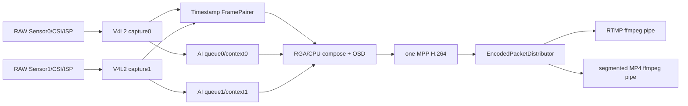

# 双路数据流与 Buffer 生命周期

Capture 线程只做 DQBUF、元数据和有界入队。`FramePairer`/AI/Pair queue 都有上限，满队列丢旧并计数。AI 分支在复制 NV12 后释放 camera lease，慢推理不能占满 V4L2 slot。Compose 通过 RGA 做 NV12→BGR 色彩转换和每路缩放，CPU/OpenCV 做经过测试的 letterbox、OSD 和 BGR→NV12 保守回退，生成独立的 packed NV12 工作缓冲；不直接修改驱动复用的 mmap buffer。

`CameraState` 持有 fd、mmap、DMA-BUF export fd 和 slot；`FrameLease` 的最后一次释放才执行 QBUF。停止先 `stop_accepting()`，等待 in-flight 归零，再 STREAMOFF、munmap、close。MPP 使用独立输入工作缓冲；在目标 BSP 的 `encode_put_frame/get_packet` completion 尚未实测前，超时/错误路径保持 faulted，不把未确认的硬件访问当作完成。

编码包由 `EncodedPacket` 的 `shared_ptr<const vector<uint8_t>>` 共享给 RTMP 和 MP4 sink，各 sink 独立失败，网络或磁盘阻塞不会回写 Capture。PTS/DTS 在 distributor 入口强制单调，Annex-B NAL 类型 5 被标记为 keyframe。SPS/PPS 由 MPP header 先写入各 sink；实际 ffprobe/拉流结果需板端记录。
