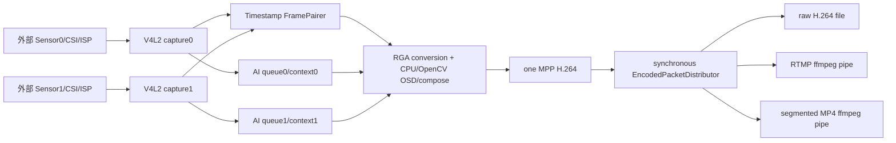

# 双路数据流与 Buffer 生命周期

当前调用入口为 `main.cpp` → `DualCameraPipeline`，详见 [当前架构](CURRENT_ARCHITECTURE.md)。Sensor/CSI/ISP/rkAIQ 配置是外部 BSP 前置条件。

Capture 线程执行 DQBUF、元数据收集、配帧和有界入队；FramePairer、pair queue、各 AI queue 均有容量限制，满队列按策略丢帧并统计。AI 分支复制 NV12 后释放自己的 camera lease；配帧/编码分支持有的引用仍独立影响槽位回收。

Compose 使用独立工作缓冲；RGA 用于色彩转换/缩放尝试，CPU/OpenCV 完成 letterbox、OSD 和保守转换 fallback。软件坐标/拼接测试不覆盖真实 RGA import、cache/fence 或目标 SDK 行为。

`CameraState` 持有 fd、mmap、DMA-BUF export fd 和 slot；最后一个 `FrameLease` 释放才触发 QBUF。停止流程包括关闭队列、join、`stop_accepting()`、等待 lease 归零、STREAMOFF 和资源清理。队列有界不代表 RKNN、阻塞 pipe 写入或 `pclose` 有界；当前不能保证任意驱动/服务器故障下及时退出。

MPP 使用独立输入缓冲；timeout/错误使 encoder faulted，未确认的输入保持到 teardown。目标 BSP 的硬件 completion、timeout/reset 和销毁语义尚待确认。EXPBUF 不等于下游已实现 DMA-BUF import。

编码包以 `shared_ptr<const vector<uint8_t>>` 共享。`EncodedPacketDistributor::publish` 依次同步调用各 sink，统计失败并继续调用其他 sink，但没有独立 sink 线程/队列；慢输出会阻塞 Encode、累积队列并产生丢帧，不能承诺断网期间录像不受影响。

分发器检查内部 PTS/DTS 单调性；ffmpeg stdin 接收 Annex-B 字节流和配置帧率，不携带应用逐包 PTS。SPS/PPS、重新连接、分段 MP4、服务端时钟与可播放性均需目标验收，不能从共享包元数据推断已通过。
