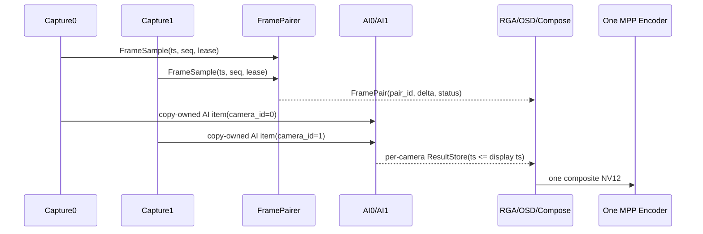

# 同步设计与测量

## S1 软件配帧

每个 `FrameSample` 携带 `camera_id`、源 sequence、V4L2 timestamp、归一化 timestamp、clock domain 和 `CameraFrame` lease。`FramePairer` 为两路维护有界单调队列，只有时钟域已知且相同、`abs(t0-t1) <= tolerance_ns` 才产生 `FramePair`。多个候选会选择差值最小且不重复消费的单调组合；超出窗口的旧帧、乱序帧和超时帧会丢弃并统计。

`drop-older` 是默认严格策略，配不上就释放 lease；`hold-last` 只用于展示降级，结果标为 `STALE`，不计入 `matched_pairs`。关闭时 `clear()` 释放所有队列中的 lease。统计包括配对成功率、两路 source drop、pair drop、最大队列深度和 `abs(delta)` 的 P50/P95/P99。

## S2 内核采集时间戳

`V4L2IspCamera` 保留 `timestamp_flags`、`timestamp_source_flags`、`clock_domain`、sequence、bytesused 和 plane offset。代码不会用 DQBUF 线程的 `clock_gettime()` 代替驱动时间戳，也不会把两个 `STREAMON` 的先后当作同步控制。板端必须保存 `media-ctl -p`、`v4l2-ctl --all` 和原始 pair CSV，再确认 timestamp 是 SOF、EOF 还是其他触发点。

## S3 硬件曝光同步

当前没有 Sensor 型号、数据手册、原理图和 BSP，因此 `hardware` 模式 fail-fast。只有确认 FSIN/Trigger、共享时钟/电平、驱动寄存器和启动顺序，并用 SOF/示波器证据验证后，才允许增加真实 trigger backend。软件配帧不能证明同时曝光。

## 时序

板端报告必须把 `NOT_MEASURED` 与模拟测试分开。模拟测试只证明匹配算法、背压和 lease 清理，不证明曝光同步。
