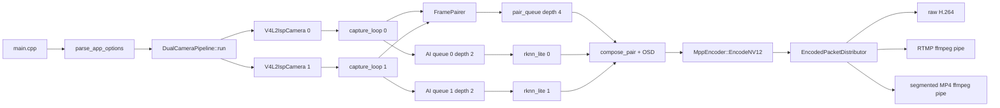

# 00 当前项目源码结构与证据索引

索引更新：2026-11-16（Asia/Shanghai）。本文用于面试准备，区分源码、主机测试、目标构建和板端证据；现行依据为 [当前架构](../CURRENT_ARCHITECTURE.md) 与 [执行和验证状态](../CODEX_EXECUTION_STATUS.md)。本轮已发现可用的 Visual Studio / MSVC 工具，CMake 配置、构建和测试结果统一记录在状态文档，不再根据 PATH 或历史报告断言“无 C++ toolchain”。

## 证据等级

| 标签 | 含义 | 当前状态 |
|---|---|---|
| `SOURCE_IMPLEMENTED` | 当前源码有接口和调用关系 | 双路 V4L2 目标路径，以及独立 VirtualSensor / RAW10 / Software ISP / AE/AWB 主机路径 |
| `HOST_STATIC_PASS` | Python/结构检查实际通过 | `validate_project.py`、两个 analyzer 测试套件、`compileall` |
| `HOST_BUILD_AND_TEST` | 主机 CMake/C++ 构建和测试单独记录 | 工具已发现；实际执行、失败或通过以状态文档为准，不扩展为目标板验证 |
| `TARGET_NOT_BUILT` | RK3588 交叉构建未完成 | 缺 RKNN/MPP/RGA/OpenCV 兄弟目录和工具链 |
| `BOARD_NOT_VERIFIED` | 没有 Sensor、media graph、RAW/NV12 实采或长稳日志 | 当前成立 |
| `BLOCKED_BY_HARDWARE` | 需要真实板卡、模组、原理图、DTS 或 BSP | Sensor/DTS/RKISP/同步曝光 |
| `BLOCKED_BY_SDK` | 需要真实 rkAIQ/IQ/MPP/RKNN SDK | rkAIQ context、IQ load、completion |
| `THEORY_ONLY` | 知识或占位模板不能当作实现 | 真实 Sensor driver、板级 DTS、FSIN/Trigger；独立软件 AE/AWB 已有源码，真实 rkAIQ AE/AWB 控制仍缺后端 |

源码存在不等于编译通过，更不等于 RK3588 板端通过。

## Git 与构建入口

| 路径/行号 | 作用 | 证据边界 |
|---|---|---|
| `main.cpp:19-101` | 注册信号、解析参数、组装 `DualCameraPipelineConfig`、调用 `run()` 和 `stats()` | 双路入口源码存在 |
| `include/app_options.h:6-50` | 双路节点、输出、同步、AI、推流和录像参数 | 参数模型存在 |
| `lib/app_options.cpp` / `parse_app_options` | 参数解析、范围检查和双路节点配置 | CLI 测试见 `camera_lifecycle_test.cpp`，执行结果见状态文档 |
| `CMakeLists.txt` / `BUILD_HOST_TESTS` | 注册主机 C++ 和 Python 测试 | 实际配置、构建与 CTest 结果见状态文档 |
| `CMakeLists.txt` / `BUILD_BSP_TOOLS` | `media_graph_validator`、`isp_control_cli`、`isp_debug_tool` | 主机工具测试不能证明真实 BSP / rkAIQ 控制可用 |
| `CMakeLists.txt` / `BUILD_RK_DEMO` | Linux 且 RKNN/MPP/RGA/OpenCV 依赖满足时创建 `myDemo` | RK3588 目标构建与板端运行仍需单独证据 |
| `tools/camera_isp_demo.cpp` / `BUILD_SOFTWARE_DEMO` | 独立 VirtualSensor / Software ISP 演示入口 | 不经过 `main.cpp`，不调用真实 V4L2 / rkAIQ / RKNN / MPP |
| `README.md:1-41` | 目标架构和命令示例 | 目标配置说明，不能作为板端证据 |

旧报告中的 `HEAD=6085dab`、大量未提交 / untracked 文件等描述属于历史检查快照，不是当前 Git 状态。复核版本时使用 `git status --short --branch` 与 `git log -1`，不要把固定旧提交号当作现行全部实现。

## RK3588 目标路径调用链

## 独立主机 Software ISP 路径

`camera_isp_demo` 的入口是 `tools/camera_isp_demo.cpp`：VirtualSensor → 标准 RAW10 → SoftwareIsp → RGB888 / NV12；双路模拟场景复用 FramePairer、Demo AI 和 CPU 合成。它不是 `main.cpp` 的 RK3588 目标路径，也不等于真实 Sensor → RKISP/rkAIQ。

| 源码 | 职责 | 证据边界 |
|---|---|---|
| `include/camera/virtual_sensor.h`、`lib/camera/virtual_sensor.cpp` | 确定性场景、模拟曝光/增益、sequence / timestamp | 虚拟数据，不是 IMX415 实采 |
| `include/camera/raw10.h`、`lib/camera/raw10.cpp` | RAW10 pack / unpack | 主机边界测试不能替代目标驱动格式验证 |
| `include/isp/isp_pipeline.h`、`lib/isp/isp_pipeline.cpp` | BLC/DPC/LSC、demosaic、软件 AWB、CCM/gamma/降噪/锐化及 NV12 输出 | 软件像素处理，不调用 RKISP/rkAIQ |
| `include/isp/ae_controller.h`、`lib/isp/ae_controller.cpp` | 软件 AE 根据统计更新曝光和增益，演示程序反馈到 VirtualSensor | 不控制真实 Sensor；算法测试状态见验证记录 |
| `include/isp/isp_profile.h`、`configs/isp/imx415_1080p.yaml` | 软件 profile 读写、应用与回滚 | 不是 Rockchip IQ 文件或加载证明 |
| `lib/ai/inference_backend.cpp` | Demo 检测和 ONNX / RKNN unavailable 边界 | Demo 结果为模拟输出；不能宣称真实推理已运行 |

软件 AE/AWB 源码已经存在；真实 rkAIQ 的 AE/AWB / exposure / gain setter 仍返回 Unsupported，两者必须分开讲。

## V4L2 / CameraFrame

| 路径/行号 | 关键函数 | 能够支持的表述 |
|---|---|---|
| `lib/v4l2_isp_camera.cpp:203-327` | `open()`、`VIDIOC_QUERYCAP`、格式枚举、`VIDIOC_S_FMT` | 用户态尝试协商 NV12/NV12M |
| `:340-364` | `G_PARM/S_PARM` | 读取/尝试设置帧率；实际 FPS 仍需设备证明 |
| `:386-465` | `REQBUFS/QUERYBUF/mmap/EXPBUF` | MMAP buffer 管理，EXPBUF 只导出 fd |
| `:484-505` | `start()` | QBUF 后 STREAMON |
| `:506-698` | `poll/DQBUF`、offset/bytesused/stride 校验 | 从 V4L2 video node 形成 `CameraFrame` |
| `:699-730` | `stop()` | 等待 lease、STREAMOFF、munmap、close |
| `include/camera_frame.h:76-103` | `BufferLeaseState::release` | 最后一个引用才 QBUF |
| `include/camera_frame.h:133-178` | `FrameLease/CameraFrame` | shared owner 延长 `CameraState` 生命周期 |

这条链从已经存在的 V4L2 输出节点开始，不包含 Sensor driver、DTS、CSI/DPHY 或 rkAIQ。

## FramePairer

| 路径/行号 | 关键函数 | 能够支持的表述 |
|---|---|---|
| `lib/frame_pairer.cpp:30-48` | 构造和 `configure` | 容差、最大等待、策略可配置 |
| `:61-67` | `compatible_clock_domains` | Unknown/不一致时钟域不比较 |
| `:88-160` | `drain_ready_locked` | 在容差内寻找最小 delta |
| `:162-194` | `expire_locked` | 超时丢弃或 HoldLast stale |
| `:197-231` | `push/tick` | 乱序、队列深度和等待处理 |
| `:243-253` | `stats/pending` | P50/P95/P99 和 pending 统计 |

这是软件时间戳配帧，不是同步曝光。`lib/dual_camera_pipeline.cpp:392-393` 在没有 FSIN/Trigger backend 时对 hardware 模式 fail-fast。

## AI、RGA、OSD

| 路径/行号 | 内容 | 限制 |
|---|---|---|
| `lib/dual_camera_pipeline.cpp:286-317` | AI queue、NV12 copy、RGA/OpenCV、RKNN、snapshot | 同步 `interf()` 没有取消协议 |
| `include/rknnPool.hpp:63-210` | `rknn_init/query/inputs_set/run/outputs_get` | 真实 runtime/model 未验证；输入 fmt 需核对 |
| `lib/postprocess.cpp` | 三尺度 YOLO 风格反量化/NMS/框输出 | NMS 修正以当前源码为准；真实模型 shape、类别和量化契约仍须目标验证 |
| `lib/dual_camera_pipeline.cpp:319-364` | 左右 ROI、缩放、OSD、BGR→NV12 | RGA/CPU 目标路径未板测 |
| `lib/composite_processor.cpp:108-153` | `map_box/clip_box` | 负责坐标映射和裁剪 |

## MPP 与多 sink

| 路径/行号 | 内容 | 限制 |
|---|---|---|
| `lib/mpp_encoder.cpp:42-309` | MPP context、编码配置、输入 buffer | 依赖目标 SDK |
| `:322-437` | `Encode/EncodeNV12`、packet 轮询 | completion/flush 语义未验证 |
| `:440-475` | SPS/PPS/extra info | header 可用性未板测 |
| `:477-529` | teardown | timeout 后保守保留 pending buffer |
| `lib/encoded_packet_fanout.cpp:15-49` | 共享 packet 给多个 sink | 同步调用，不等于异步隔离 |
| `lib/dual_camera_pipeline.cpp:122-174,366-380,410-433` | ffmpeg stdin、编码和 sink | ffmpeg/server/player 未验证 |

## ISP/rkAIQ 证据边界

- `lib/aiq_controller.cpp:83-99` 只发现进程/路径并将 IQ 标为 `UNVERIFIED`。
- `lib/aiq_controller.cpp:102-124` 的 AE/AWB/exposure/gain 控制全部返回 `Unsupported`。
- `scripts/isp_quality_analyzer.py:27-58,212-292` 是主机 RAW/NV12 离线分析，不是硬件 ISP。
- `docs/isp/01_IMX415_HARDWARE_COMPATIBILITY.md` 至 `13_ISP_IMPLEMENTATION_STATUS.md` 明确缺少板卡、BSP、DTS、Sensor、IQ 和 rkAIQ 证据。

## 测试索引

历史 Python 结果作为覆盖索引保留；本轮命令、工具版本、执行结果与日志统一见 [执行和验证状态](../CODEX_EXECUTION_STATUS.md)。主机 CTest 不会编译或验证 Linux V4L2 / RKNN / RGA / MPP 目标路径。

| 命令/文件 | 覆盖 | 当前状态 |
|---|---|---|
| `python tests/validate_project.py` | 文件/token/结构检查 | 本轮输出和文件数量见状态文档；不等于编译验收 |
| `python -m unittest discover -s tests -p 'test_isp_quality_analyzer.py'` | 6 个 RAW/NV12 用例 | 通过 |
| `python -m unittest discover -s tests -p 'isp_quality_analyzer_test.py'` | 3 个 RAW/NV12 用例 | 通过 |
| `python -m compileall -q scripts tests` | Python 语法 | 通过 |
| `tests/camera_lifecycle_test.cpp` | lease、队列、CLI | 构建和运行结果见状态文档 |
| `tests/frame_pairer_test.cpp` | 容差、乱序、时钟域、超时 | 构建和运行结果见状态文档 |
| `tests/composite_processor_test.cpp` | NV12 几何/布局 | 构建和运行结果见状态文档 |
| `tests/encoded_packet_fanout_test.cpp` | payload、PTS、sink | 构建和运行结果见状态文档 |
| `tests/media_graph_validator_test.cpp` | 合成 graph 文本 | 构建和运行结果见状态文档 |
| `tests/raw_virtual_sensor_test.cpp`、`tests/software_isp_test.cpp` | RAW10、虚拟传感器、软件 ISP | 构建和运行结果见状态文档 |
| `tests/ae_profile_test.cpp`、`tests/ai_backend_test.cpp` | 软件 AE / profile 与 Demo / unavailable backend | 不代表真实 rkAIQ / RKNN；执行结果见状态文档 |
| CMake / MSVC / CTest | 主机 C++ 构建和运行 | 已发现 Visual Studio 工具；实际结果见状态文档，RK3588 目标仍需单独构建 |

## 面试使用原则

可以说“实现了独立 VirtualSensor、RAW10 和 Software ISP / AE/AWB 源码，以及待板端验证的双路 V4L2、软件配帧、lease、RKNN/RGA/MPP 调用结构”；主机测试通过的具体范围以状态文档为准。不能把软件 AE/AWB 说成真实 rkAIQ 控制或成像调优，也不能宣称已完成 Sensor driver、板级 DTS、硬件同步、DMA-BUF 零拷贝或 RK3588 板端性能验收。
