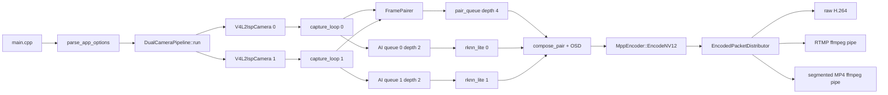

# 00 当前项目源码结构与证据索引

审计对象是 `demo_multhread_decode_infer_mulmodel` 当前工作树。本文用于面试准备，所有结论都区分源码存在、主机验证、目标构建和板端验证。

## 证据等级

| 标签 | 含义 | 当前状态 |
|---|---|---|
| `SOURCE_IMPLEMENTED` | 当前工作树有源码和调用关系 | 双路 V4L2、软件配帧、RKNN/RGA/OSD、单 MPP 编码、多 sink |
| `HOST_STATIC_PASS` | Python/结构检查实际通过 | `validate_project.py`、两个 analyzer 测试套件、`compileall` |
| `HOST_CXX_NOT_RUN` | CMake/C++/CTest 没执行 | 本机缺 CMake 和 C++ toolchain |
| `TARGET_NOT_BUILT` | RK3588 交叉构建未完成 | 缺 RKNN/MPP/RGA/OpenCV 兄弟目录和工具链 |
| `BOARD_NOT_VERIFIED` | 没有 Sensor、media graph、RAW/NV12 实采或长稳日志 | 当前成立 |
| `BLOCKED_BY_HARDWARE` | 需要真实板卡、模组、原理图、DTS 或 BSP | Sensor/DTS/RKISP/同步曝光 |
| `BLOCKED_BY_SDK` | 需要真实 rkAIQ/IQ/MPP/RKNN SDK | rkAIQ context、IQ load、completion |
| `THEORY_ONLY` | 只有知识或模板，不能说项目已实现 | Sensor driver、DTS、AE/AWB、硬件同步 |

源码存在不等于编译通过，更不等于 RK3588 板端通过。

## Git 与构建入口

| 路径/行号 | 作用 | 证据边界 |
|---|---|---|
| `main.cpp:19-101` | 注册信号、解析参数、组装 `DualCameraPipelineConfig`、调用 `run()` 和 `stats()` | 双路入口源码存在 |
| `include/app_options.h:6-50` | 双路节点、输出、同步、AI、推流和录像参数 | 参数模型存在 |
| `lib/app_options.cpp:67-180` | 参数解析、范围检查和 MIPI-only 约束 | C++ 测试源码存在，未编译 |
| `CMakeLists.txt:13-53` | host C++ 测试和 Python 测试注册 | 本机未 configure |
| `CMakeLists.txt:55-70` | `media_graph_validator`、`isp_control_cli`、`isp_debug_tool` | 目标源码存在，未构建 |
| `CMakeLists.txt:73-134` | RKNN/MPP/RGA/OpenCV 依赖满足时创建 `myDemo` | 兄弟 SDK 缺失，未构建 |
| `README.md:1-41` | 目标架构和命令示例 | 目标配置说明，不能作为板端证据 |

当前 Git 工作区包含大量未提交和 untracked 文件。新增文档、工具和测试必须以工作树为准，不能把 `HEAD=6085dab` 当成全部实现。

## 真实调用链

## V4L2 / CameraFrame

| 路径/行号 | 关键函数 | 能够支持的表述 |
|---|---|---|
| `lib/v4l2_isp_camera.cpp:203-327` | `open()`、`VIDIOC_QUERYCAP`、格式枚举、`VIDIOC_S_FMT` | 用户态尝试协商 NV12/NV12M |
| `:340-364` | `G_PARM/S_PARM` | 读取/尝试设置帧率；实际 FPS 仍需设备证明 |
| `:386-465` | `REQBUFS/QUERYBUF/mmap/EXPBUF` | MMAP buffer 管理，EXPBUF 只导出 fd |
| `:484-505` | `start()` | QBUF 后 STREAMON |
| `:506-698` | `poll/DQBUF`、offset/bytesused/stride 校验 | 从 V4L2 video node 形成 `CameraFrame` |
| `:699-730` | `stop()` | 等待 lease、STREAMOFF、munmap、close |
| `include/camera_frame.h:76-103` | `BufferLeaseState::release` | 最后一个引用才 QBUF |
| `include/camera_frame.h:133-178` | `FrameLease/CameraFrame` | shared owner 延长 `CameraState` 生命周期 |

这条链从已经存在的 V4L2 输出节点开始，不包含 Sensor driver、DTS、CSI/DPHY 或 rkAIQ。

## FramePairer

| 路径/行号 | 关键函数 | 能够支持的表述 |
|---|---|---|
| `lib/frame_pairer.cpp:30-48` | 构造和 `configure` | 容差、最大等待、策略可配置 |
| `:61-67` | `compatible_clock_domains` | Unknown/不一致时钟域不比较 |
| `:88-160` | `drain_ready_locked` | 在容差内寻找最小 delta |
| `:162-194` | `expire_locked` | 超时丢弃或 HoldLast stale |
| `:197-231` | `push/tick` | 乱序、队列深度和等待处理 |
| `:243-253` | `stats/pending` | P50/P95/P99 和 pending 统计 |

这是软件时间戳配帧，不是同步曝光。`lib/dual_camera_pipeline.cpp:392-393` 在没有 FSIN/Trigger backend 时对 hardware 模式 fail-fast。

## AI、RGA、OSD

| 路径/行号 | 内容 | 限制 |
|---|---|---|
| `lib/dual_camera_pipeline.cpp:286-317` | AI queue、NV12 copy、RGA/OpenCV、RKNN、snapshot | 同步 `interf()` 没有取消协议 |
| `include/rknnPool.hpp:63-210` | `rknn_init/query/inputs_set/run/outputs_get` | 真实 runtime/model 未验证；输入 fmt 需核对 |
| `lib/postprocess.cpp:283-395` | 三尺度 YOLO 风格反量化/NMS/框输出 | 模型输出契约和当前索引问题需修复/验证 |
| `lib/dual_camera_pipeline.cpp:319-364` | 左右 ROI、缩放、OSD、BGR→NV12 | RGA/CPU 目标路径未板测 |
| `lib/composite_processor.cpp:108-153` | `map_box/clip_box` | 负责坐标映射和裁剪 |

## MPP 与多 sink

| 路径/行号 | 内容 | 限制 |
|---|---|---|
| `lib/mpp_encoder.cpp:42-309` | MPP context、编码配置、输入 buffer | 依赖目标 SDK |
| `:322-437` | `Encode/EncodeNV12`、packet 轮询 | completion/flush 语义未验证 |
| `:440-475` | SPS/PPS/extra info | header 可用性未板测 |
| `:477-529` | teardown | timeout 后保守保留 pending buffer |
| `lib/encoded_packet_fanout.cpp:15-49` | 共享 packet 给多个 sink | 同步调用，不等于异步隔离 |
| `lib/dual_camera_pipeline.cpp:122-174,366-380,410-433` | ffmpeg stdin、编码和 sink | ffmpeg/server/player 未验证 |

## ISP/rkAIQ 证据边界

- `lib/aiq_controller.cpp:83-99` 只发现进程/路径并将 IQ 标为 `UNVERIFIED`。
- `lib/aiq_controller.cpp:102-124` 的 AE/AWB/exposure/gain 控制全部返回 `Unsupported`。
- `scripts/isp_quality_analyzer.py:27-58,212-292` 是主机 RAW/NV12 离线分析，不是硬件 ISP。
- `docs/isp/01_IMX415_HARDWARE_COMPATIBILITY.md` 至 `13_ISP_IMPLEMENTATION_STATUS.md` 明确缺少板卡、BSP、DTS、Sensor、IQ 和 rkAIQ 证据。

## 测试索引

| 命令/文件 | 覆盖 | 当前状态 |
|---|---|---|
| `python tests/validate_project.py` | 文件/token/结构检查 | `PASS (36 required files)` |
| `python -m unittest discover -s tests -p 'test_isp_quality_analyzer.py'` | 6 个 RAW/NV12 用例 | 通过 |
| `python -m unittest discover -s tests -p 'isp_quality_analyzer_test.py'` | 3 个 RAW/NV12 用例 | 通过 |
| `python -m compileall -q scripts tests` | Python 语法 | 通过 |
| `tests/camera_lifecycle_test.cpp` | lease、队列、CLI | 源码存在，未编译 |
| `tests/frame_pairer_test.cpp` | 容差、乱序、时钟域、超时 | 源码存在，未编译 |
| `tests/composite_processor_test.cpp` | NV12 几何/布局 | 源码存在，未编译 |
| `tests/encoded_packet_fanout_test.cpp` | payload、PTS、sink | 源码存在，未编译 |
| `tests/media_graph_validator_test.cpp` | 合成 graph 文本 | 源码存在，未编译 |
| CMake/CTest | C++ 构建和运行 | 本机缺 `cmake/ctest/g++/clang++/cl` |

## 面试使用原则

可以说“实现了待板端验证的双路 V4L2 用户态链路、软件配帧、lease、RKNN/RGA/MPP 结构”；不能说完成 Sensor Driver、DTS、rkAIQ、AE/AWB、硬件同步、零拷贝或板端性能优化。
