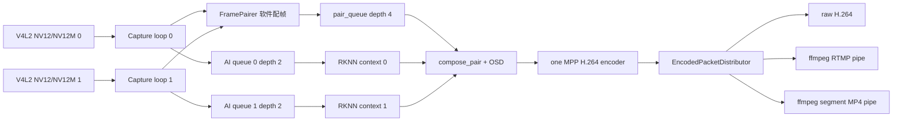
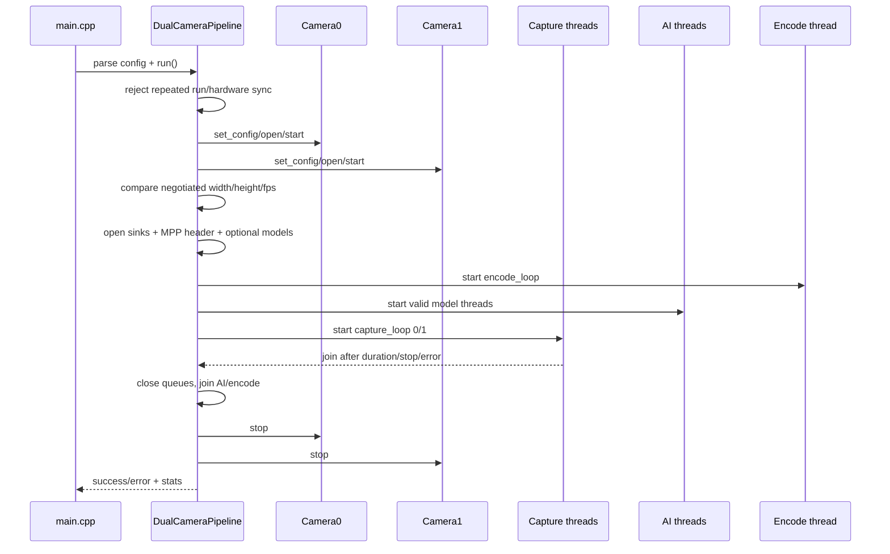

# 02 项目架构、执行流程与资源生命周期

## 1. 架构总览

当前工作树的用户态链路是：



Sensor、MIPI CSI-2、DPHY、RKCIF、RKISP 和 rkAIQ 不在仓库源码中；它们是 V4L2 输出节点能够提供 NV12/NV12M 的板端前提。

## 2. 启动时序



源码：`main.cpp:19-101`、`lib/dual_camera_pipeline.cpp:387-451`。当前 `run_started` 使一个 pipeline 实例只能运行一次。

## 3. 线程职责

| 线程 | 入口 | 主要工作 | 共享数据 |
|---|---|---|---|
| Capture 0/1 | `dual_camera_pipeline.cpp:238-284` | dequeue、元数据、FramePairer、AI 入队 | CameraFrame/lease |
| AI 0/1 | `:286-317` | packed copy、RGA/OpenCV、RKNN、snapshot | AI queue、ai_snapshot |
| Encode | `:366-380` | compose、OSD、NV12、MPP、sink | pair queue、encoder、distributor |
| Main | `main.cpp:19-101` | 参数、启动、join、打印统计 | pipeline lifetime |

队列：`pair_queue` 深度 4；两个 AI queue 深度 2；`BoundedFrameQueue::push_drop_oldest` 在满载时丢旧并返回标志。

## 4. Camera Buffer 生命周期

```mermaid
stateDiagram-v2
    [*] --> Queued
    Queued --> Dequeued: VIDIOC_DQBUF
    Dequeued --> InUse: BufferLeaseState::acquire
    InUse --> InUse: copy to pair/AI queues
    InUse --> Queued: last FrameLease release -> QBUF
    Queued --> Stopped: STREAMOFF/cleanup
```

关键路径：

1. `V4L2IspCamera::dequeue()` 从 driver 得到 index、plane、bytesused、stride、timestamp。
2. `CameraFrame.owner` 保持 `CameraState`，`FrameLease` 保持归还状态。
3. pair queue 和 AI queue 只复制 shared ownership，消费者不能 close DMA-BUF/mmap。
4. 最后一个 lease 的析构调用 `BufferLeaseState::release()`，再通过 callback QBUF。
5. `stop()` 先 `stop_accepting()`，等待 in-flight lease 归零，再 STREAMOFF、munmap、close。

源码：`lib/v4l2_isp_camera.cpp:506-698`、`:699-730`；`include/camera_frame.h:76-178`。

## 5. 帧配对算法

`FrameSample` 包含 camera id、sequence、timestamp、normalized timestamp、arrival time、clock domain 和 CameraFrame。`FramePairer`：

- `compatible_clock_domains()` 拒绝 Unknown 或不一致域；
- 在两个有界队列中搜索容差内的最小 delta；
- 旧帧、乱序和超时会丢弃并计数；
- `hold-last` 返回 stale pair，不能冒充同步曝光。

源码：`lib/frame_pairer.cpp:61-231`。硬件同步模式在 `lib/dual_camera_pipeline.cpp:392-393` 没有真实 FSIN/Trigger backend 时直接返回失败。

## 6. AI 结果时序

AI item 记录 `sequence` 和 `timestamp_ns`。AI 线程先复制 NV12，再清空 item.frame，避免模型调用期间长期占用相机 slot。`AiSnapshot` 写入每路最新结果。compose 阶段检查：

- snapshot timestamp 不晚于当前 frame timestamp；
- strict 模式要求 sequence 相等；
- 不满足条件就显示 `AI_WAIT`，不画过期框。

源码：`lib/dual_camera_pipeline.cpp:286-317,325-360`。模型调用本身是同步函数，当前没有可验证取消机制。

## 7. 图像转换、拼接和 OSD

`compose_pair()` 的逻辑是：

1. `copy_nv12()` 按 stride 拷贝两个 CameraFrame 到 packed NV12；
2. `nv12_to_bgr_rga()` 优先调用 RGA，失败时 OpenCV fallback；
3. 根据 `CompositeLayout` 将两路 BGR 缩放到左右 ROI；
4. 根据 AI snapshot 做坐标映射、clip、rectangle 和文字 OSD；
5. 写入同步 delta/status 文本；
6. `bgr_to_nv12()` 转换为编码输入。

源码：`lib/dual_camera_pipeline.cpp:48-100,319-364`、`lib/composite_processor.cpp:70-153`。当前路径有 CPU copy，不能写成零拷贝。

## 8. 编码与 sink

`MppEncoder::EncodeNV12()` 将 packed NV12 转成 encoder 自有 I420 workspace，再调用 MPP。`encode_loop()` 使用一个 MPP encoder 对拼接后的画面编码，并把 payload 包装成 `EncodedPacket`。`EncodedPacketDistributor` 顺序调用 raw/RTMP/MP4 sink。

注意：

- MPP timeout/completion/flush 依赖目标 BSP，未完成板端证据；
- `FfmpegPipe::write()` 使用同步 `fwrite`，慢 sink 可能阻塞编码；
- sink false 和 final flush 的错误传播仍是源码审查风险；
- 共享 `std::shared_ptr<vector<uint8_t>>` 是应用层 payload 共享，不是硬件 DMA-BUF 零拷贝。

源码：`lib/mpp_encoder.cpp:322-529`、`lib/encoded_packet_fanout.cpp:15-49`、`lib/dual_camera_pipeline.cpp:122-174,366-380,410-451`。

## 9. 关闭时序与异常

正常关闭顺序：

1. signal 或 duration 设置 stop；
2. capture threads 退出并关闭 pair/AI queue；
3. join AI threads 和 encode thread；
4. Release MPP、flush/close output/sinks；
5. stop 两个 V4L2 camera，等待 lease 后 STREAMOFF；
6. 返回 stats/error。

需要诚实说明的限制：

- AI/RKNN 调用没有 SDK 级取消；
- MPP completion 未由目标 BSP 证明；
- sink slow/failure 仍可能影响 encode thread；
- 中途初始化失败主要依赖外层析构完成最终清理。

## 10. 验证状态

| 项目 | 当前状态 |
|---|---|
| 源码结构和调用关系 | `SOURCE_IMPLEMENTED` |
| Python analyzer/结构检查 | `HOST_STATIC_PASS` |
| C++ host build/CTest | `NOT_TESTED`，本机无 CMake/C++ |
| RKNN/MPP/RGA/OpenCV target build | `NOT_TESTED` |
| IMX415 Sensor/DTS/ISP/rkAIQ | `BLOCKED_BY_HARDWARE/SDK` |
| 双路软件配帧 | 源码存在，未板端运行 |
| 硬件同步曝光 | `NOT_IMPLEMENTED` |
| RTMP/MP4 播放和服务器 | `NOT_TESTED` |
| FPS/延迟/CPU/RSS/长稳 | `NOT_MEASURED` |

## 11. 面试表达

建议说：“我实现的是从 V4L2 ISP 输出开始的双路用户态链路，重点是 buffer lease、软件配帧、AI 时序、拼接和单编码多目的分发。Sensor driver、DTS、rkAIQ 和硬件同步属于需要目标 BSP/板卡证据的部分。”

不要说：“我已经完成 IMX415 Sensor bring-up、RKISP 调优、rkAIQ AE/AWB、硬件同步曝光或零拷贝性能优化。”
