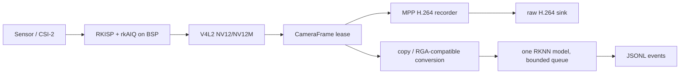

# G0：真实仓库审计

审计日期：2026-11-11（Asia/Shanghai）

## 基线事实

- 初始审计时工作目录中的工程是 `demo_multhread_decode_infer_mulmodel`，当时没有 `.git` 目录，因此无法读取分支、提交或工作区差异；之后只在本地初始化 Git 元数据并保留了现有文件。
- 根目录已有的 `build/` 是在 `/home/firefly/项目/project1/demo_multhread_decode_infer_mulmodel` 生成的 Linux CMake 构建树，`build/myDemo` 是 ELF 二进制，不能当作本机本次改动的构建结果。
- Windows 当前 PATH 没有 `cmake`、`ctest`、`g++`、`clang++` 或 `cl.exe`；WSL 没有可用发行版响应。RKNN、MPP、RGA、FFmpeg-lite 和 OpenCV 的兄弟目录也不在当前快照中。
- 工程约束来自仓库内的 `agent.md`（最小修改、先验证、显式错误处理）以及用户提供的 `CODEX_CAMERA_ISP_EXECUTION_PLAN.md`。执行文档中的路径和接口仅作要求，不作为现有代码事实。

## 现有模块和实际调用关系

| 模块 | 真实文件 | 观察到的职责 |
| --- | --- | --- |
| 入口/旧模式 | `main.cpp` | 原先直接读取 `argv[1]` 作为路数；创建 `StreamLoader`、多个 `rknn_lite`、四宫格合成线程和 `StreamingManager`。现已保留 legacy 分支并加入参数校验、Ctrl+C 退出和资源回收。 |
| 输入/解码 | `include/stream_loader.h`, `lib/stream_loader.cpp` | FFmpeg `avformat_open_input`/`av_read_frame`，H.264 Annex-B bitstream filter，`MppDecoder::Decode`。本地 MP4 循环重开，RTSP/RTMP 失败重连。 |
| 解码回调 | `mpp_decoder_frame_callback` | 按 stride 拷贝 NV12 到 `Mbuffer::yuv_work`，优先 RGA NV12→BGR，失败回退 OpenCV，写入 `Mbuffer::img`。 |
| MPP 解码 | `include/mpp_decoder.h`, `lib/mpp_decoder.cpp` | MPP context、packet/frame 和回调管理。 |
| MPP 编码 | `include/mpp_encoder.h`, `lib/mpp_encoder.cpp` | 原有 BGR→RGA/OpenCV→I420→MPP 编码，RTMP sink 使用；新增 `EncodeNV12`，对 ISP NV12 做明确的 stride 拷贝/转换，未宣称 DMA-BUF 零拷贝。 |
| RGA | 各回调/编码实现中的 `imcvtcolor`/`imresize`、`RgaUtils.h` | 颜色转换和缩放；失败时有明确 OpenCV 回退。未被调用的旧 `rga_func.h` 已清理。 |
| RKNN | `include/rknnPool.hpp` | 读取 `.rknn`、查询输入输出、调用 `rknn_run`/post-process。现已将初始化失败改为可检查的 `valid()`，避免构造函数直接 `exit`。 |
| 结果融合 | `include/detection_fusion_manager.h`, `lib/detection_fusion_manager.cpp` | 四类结果的 IoU/IoM 融合、NMS 和绘制。legacy 继续使用。 |
| 推流 | `include/streaming_manager.h`, `lib/streaming_manager.cpp` | 有界队列、FFmpeg FLV/RTMP 封装和 MPP H.264 编码；legacy 保持原行为。 |
| DMA 工具 | `include/dma_alloc.hpp` | Linux dma-heap 分配、mmap、同步和释放；旧四宫格仍可复用。 |

## 新模式切入点

- `include/app_options.h` / `lib/app_options.cpp`：增加 `legacy`（默认）和 `mipi` 两种输入选择，同时保留旧的数字路数调用形式。
- `include/v4l2_isp_camera.h` / `lib/v4l2_isp_camera.cpp`：Linux-only V4L2 ISP NV12/NV12M 适配器。实际查询 capability、枚举格式、协商 G_FMT、MMAP/EXPBUF、poll/DQBUF/QBUF、sequence/timestamp 和显式 stop/join 生命周期。
- `include/camera_frame.h`：定义 CameraBuffer 描述和跨线程 lease。V4L2 buffer pool 拥有 fd/mmap，消费者只复制 `CameraFrame` 并共享最后一个 lease。
- `include/bounded_frame_queue.h`：AI 分支容量为 2，满时显式丢旧帧并由统计计数。
- `include/mipi_pipeline.h` / `lib/mipi_pipeline.cpp`：录像优先的单路链路：V4L2 NV12 → MPP H.264 elementary stream；AI 分支优先使用 RGA NV12→BGR（失败回退 OpenCV），在复制/颜色转换后释放相机 lease，再运行一个现有 RKNN 模型。
- `tests/camera_lifecycle_test.cpp`：无硬件 mock，覆盖最后一个 lease 才 QBUF、停止后不再 QBUF、AI 队列丢旧和 CLI 错误。

## 回归边界

legacy 仍使用 FFmpeg→MPP Decode→RGA/RKNN→四宫格→`StreamingManager`，未把旧输入强行改成 `/dev/video0`。mipi 模式只接受已经由 ISP 输出的 NV12/NV12M；RAW Bayer、Sensor/DTS、rkAIQ 和 IQ 文件留在板端 bring-up，不在工程中伪造。
