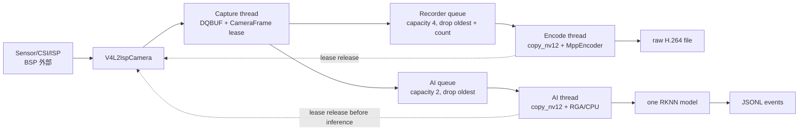

# G0：真实仓库审计（收敛后）

审计日期：2026-11-12（Asia/Shanghai）

## 结论

产品入口已收敛为单路 MIPI Camera/ISP。旧 RTSP/MP4、FFmpeg/MPP Decoder、四模型调度、四宫格融合、RTMP/FLV 推流和旧 DMA/ThreadPool 支撑文件已从源码和 CMake 目标删除；Git 删除保留历史。`docs/CODE_REVIEW_REPORT.md` 是收敛前的风险基线，不代表当前构建图。

## 当前保留模块

| 模块 | 文件 | 真实职责 |
| --- | --- | --- |
| CLI/入口 | `main.cpp`, `include/app_options.h`, `lib/app_options.cpp` | 仅解析 MIPI 参数并启动 `MipiPipeline`。 |
| V4L2 Capture | `include/v4l2_isp_camera.h`, `lib/v4l2_isp_camera.cpp` | QUERYCAP、NV12/NV12M S_FMT、G/S_PARM、MMAP/EXPBUF、poll/DQBUF/QBUF、plane layout 校验、lease 和统一 shutdown。 |
| Buffer/队列 | `include/camera_frame.h`, `include/bounded_frame_queue.h` | CameraState 唯一拥有 mmap/fd；共享 lease 最后释放才 QBUF；录像队列容量 4、AI 队列容量 2。 |
| MPP Encoder | `include/mpp_encoder.h`, `lib/mpp_encoder.cpp` | CPU packed NV12 → RGA/OpenCV I420 → MPP H.264；超时/错误保留 pending buffer，未确认异步完成前不复用。 |
| RGA/RKNN | `include/rknnPool.hpp`, `include/rknn_api.h`, `include/postprocess.h`, `lib/postprocess.cpp` | 一个 RKNN 模型、RGA/CPU 转换、后处理；多输入模型明确拒绝。 |
| Pipeline | `include/mipi_pipeline.h`, `lib/mipi_pipeline.cpp` | Capture、Encode、AI 三线程；录像写盘只在 Encode 线程，AI 限频并丢旧帧。 |

## 真实调用图

当前只验证了 CPU copy 基线。V4L2 EXPBUF 仅记录能力，MPP/RGA/RKNN 没有 DMA-BUF import、cache sync 和异步完成闭环，因此不能描述为零拷贝。

## 环境边界

当前 Windows 环境没有 CMake/C++ 编译器、Linux V4L2 头、RKNN/MPP/RGA/OpenCV SDK 或 RK3588 设备；Sensor、Media Controller、rkAIQ/IQ、实际帧率、MPP 完成语义和稳定性均待板端验证。
