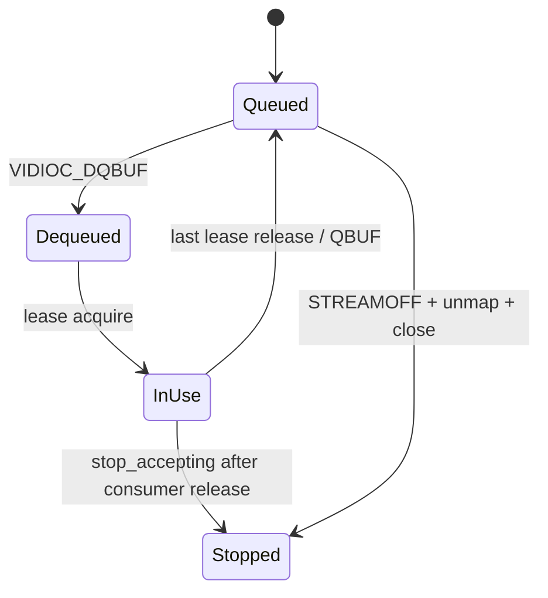

# G4：Buffer 与线程生命周期

> **历史设计：单路 Capture / Encode / AI 生命周期。**
>
> 下文的录像队列、单路 CLI、线程顺序和错误处理属于早期 MipiPipeline 方案。共享 lease 等契约须对照当前源码重核；双路配帧、合成和编码包分发的现行所有权说明见 [双路数据流与生命周期](../PIPELINE_AND_OWNERSHIP.md)。
>
> 现行依据：[当前架构](../CURRENT_ARCHITECTURE.md) · [执行与验证状态](../CODEX_EXECUTION_STATUS.md)。范围说明更新：2026-11-16（Asia/Shanghai）。

## 所有权契约

`V4L2IspCamera::CameraState` 独占 V4L2 `MMAP` 地址、DMA-BUF fd 和 slot 状态。`CameraFrame` 只携带描述、一个 `owner` shared pointer 和一个共享 `FrameLease`；AI/录像消费者不得 `close(fd)`、`munmap` 或直接 `QBUF`。

同一个相机帧复制给录像和 AI 时，两份 `CameraFrame` 共享同一 `FrameLease`。只有最后一个 shared lease 析构才会调用 `QBUF`。`BufferLeaseState::stop_accepting()` 在 `STREAMOFF` 前禁止新的归还；`stop()` 等待 in-flight 为 0，避免驱动仍访问 mmap 时释放地址。等待有 3 秒上限，超时返回错误并通过 `CameraFrame::owner` 延长资源寿命，而不是提前 unmap。

## 双分支顺序

1. Capture 线程 `poll()`、`DQBUF` 后创建 frame lease，并把同一帧副本分别提交到容量 4 的录像队列和容量 2 的 AI 队列。
2. Encode 线程从录像队列按实际 stride 拷贝到 MPP 编码器自有工作区，写 raw H.264。当前 MPP 封装没有经过 SDK 证实的 DMA-BUF import，因此代码明确使用 copy path。
3. AI 队列只保存短暂的 `CameraFrame` lease。AI worker 先完成 NV12→BGR 复制/转换，然后立即清空 frame，再执行模拟延迟或 RKNN 推理，不让 NPU 延迟占住 V4L2 slot。
4. AI 队列容量为 2，满时丢最旧项并累计 `ai_drop_oldest`；录像队列容量为 4，满时也丢最旧项，但单独累计 `record_queue_drop` 和 `capture_drop`，不伪装成无丢帧。
5. 退出时 Capture 停止接收并关闭两个队列，Encode/AI 排空后 join，最后等待 lease、`STREAMOFF`、unmap、close。Ctrl+C 和初始化半途失败走同一清理路径。

## 错误和背压

V4L2 poll 超时是可恢复状态；连续五次非超时 DQBUF 错误才让 pipeline 有界退出。MPP 编码错误和无 packet 会返回负值并终止录像线程；输出写失败也会终止 pipeline。AI 初始化失败默认禁用 AI 并继续录像；`--ai-required=true` 才将其作为硬错误。MPP timeout/非 timeout 后 pending buffer 保留到 encoder context teardown；目标 BSP 的 completion/reset 语义仍需上板确认。
